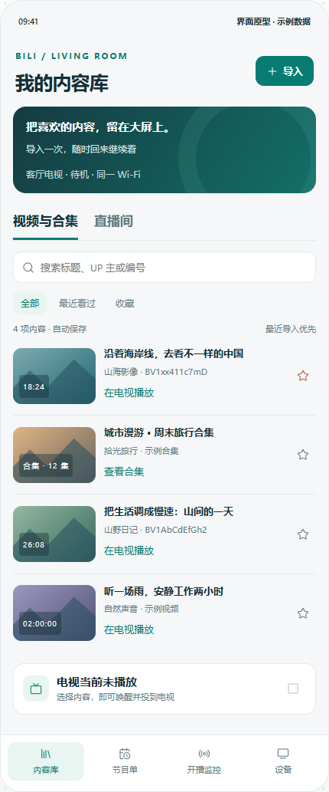

# B站直播遥控器 · 三代原生 App —— 项目总览（README）

> **一句话**：把 B站直播间 / 合集的画面，经手机 App 做 HTTP 代理、再通过局域网 ADB 拉起电视上的 mpv 播放，并能按间隔自动轮播、掉线自动换台。

> **前端开发先看效果：** [可交互原型 HTML](ui参考/三代App-可交互原型.html) · [直接下载原型](https://raw.githubusercontent.com/GoodbyeLina/CDCY-BiliTVremotecontroller/main/ui%E5%8F%82%E8%80%83/%E4%B8%89%E4%BB%A3App-%E5%8F%AF%E4%BA%A4%E4%BA%92%E5%8E%9F%E5%9E%8B.html) · [前端效果与操作说明](ui参考/README.md) · [界面预览图](ui参考/三代App-原型预览.png)
>
> 下载后用 Chrome / Edge 打开 HTML，可离线体验内容库、节目单、开播监控和配置向导。GitHub 文件页只展示源码，不会直接运行 HTML。原型使用模拟数据，视觉细节可调整，正式功能以需求表为准。

## 当前开发需求与完成情况

**更新：2026-11-21。当前版本 `3.0.0-alpha.4`（包名 `tvrc.app`，versionCode 6）新增 App 内诊断记录，可查看每次导入、直播检查、播放提交、电视回执、错误详情和耗时；导出的诊断包同步扩充运行环境与结构化事件。详见 [诊断记录说明](docs/dev/2026-11-21-diagnostics.md)。此前的 ADB、一加 Ace 3 屏幕适配和设备 IP 保存修复均保留。手机与电视的端到端功能仍需真机验收。**

下面按用户提出的 8 项需求排列。**“部分完成”表示存在底层代码，不能当作用户已经能使用。** 详细任务编号、代码依据、解析样例和逐项验收见 [完整需求与验收表](docs/requirements-v3.md)。

| # | 用户需求 | 当前完成情况 | 接下来要完成什么 | 完成后的验收方式 |
|---|---|---|---|---|
| 1 | 视频支持 BV、电脑网页网址、手机分享链接 | **首版已实现（待真机）**：标准网页/BV/分享短链走同一入口；App 内自动展开 `b23.tv` 短链并从整段分享文案提取 URL | 真机验收：网页与分享原文直接导入并播放 | 用户给出的网页和分享原文都能导入、显示正确视频并播放，无需手动截取 BV |
| 2 | 直播支持房间号、网页网址、手机分享链接 | **首版已实现（待真机）**：房间号、直播网页、分享短链均可识别；播放前查 `roomInfo()` 判开播，未开播明确提示 | 真机用 `612978` 网页及分享链接验收 | 用户给出的房间 `612978` 网页及分享链接均可识别；开播时可播放，未开播时明确提示 |
| 3 | 完成独立、功能完整的 Android App | **alpha.4 已交付（电视播放待验）**：`:app` 模块 + `dist/TVStationRemote-3.0.0-alpha.4-diagnostics.apk`，不依赖 Termux。手机端已验证视频与直播链接可成功导入 | 真机安装后完成连接电视、视频/直播/切台/停止/后台运行验证 | 安装一个 APK 即可配置和使用，不依赖 Termux；真实手机与电视完成视频、直播、切台、停止及后台运行验证 |
| 4 | 改善前端视觉与首次使用引导 | **首版已实现（待真机）**：原生四页签（内容库/节目单/开播监控/设备）+ 六项自检向导（接口/局域网/端口/ADB/播放器/内容库） | 真机走查小屏布局、空列表与失败态 | 新用户跟随引导可完成首次播放；加载、空列表、失败状态明确；小屏和深浅色显示正常 |
| 5 | 解析 B站视频合集和列表 | **首版已实现（待真机）**：合集/系列分页展开、去重保序、整组入队，视图接口补全标题与集数 | 多页合集真机导入验证 | 多页合集可完整导入，可单集播放或按序播放；不可用条目有原因提示 |
| 6 | 首页展示视频/直播列表，能找回以前看过的内容 | **首版已实现（待真机）**：`library.json` 持久内容库 + 收藏 + 最近播放 + 搜索，重复导入按内容标识合并 | 重启 App 验证内容与观看记录仍在 | 重启 App 后内容仍在；可切换列表、查看最近看过并再次播放；重复导入不重复建项 |
| 7 | 待机唤醒电视、添加节目单、每天定时播放 | **首版已实现（待真机）**：节目单增删启停 + 每日/按星期定时 + 唤醒选项 + 执行记录；电源键唤醒走 `KEYCODE_WAKEUP` | 息屏到点实测（电视保持网络与 adbd 待机） | 电视网络和 ADB 在待机时可用的条件下，手机息屏也能到点唤醒并播放指定节目单；查看执行记录 |
| 8 | 监控指定直播间，开播通知并按规则强制播放 | **首版已实现（待真机）**：自适应轮询（20–600s）+ 开播去重通知 + 优先级抢播 + 覆盖手动停止开关 + 失败退避（30s→300s）；长连接仍为后续优化 | 真机验证同一次开播只触发一次、断网不误判 | 同一次开播只触发一次；只监控主动关注的房间；可配置抢播及恢复规则；断网不误判，关闭后停止查询 |

**已确认的监控方向：**以本地自适应轮询为基础，集中调度、复用连接，非重点时段降频，失败退避；不全天对全部直播间固定高频查询。直播消息长连接先验证可靠性与耗电收益，再作为后续优化。首版不引入监控服务器。

**抢播默认规则：**尊重用户手动停止；只有明确开启“允许覆盖手动停止”的直播间才可覆盖。重点直播可按优先级打断普通节目单，下播后恢复原队列位置。

**开发顺序：**首版（链接修复与独立 APK → 内容库、合集与原生引导 → 节目单、定时和开播监控）已于 2026-11-20 一次性落地，见上表状态；剩余工作是逐项真机验收与长连接优化。前端原型已展示，视觉细节仍可调整；视频分 P、收藏夹范围、监控数量和精确续播需求见完整需求表中的待定项。

维护要求：功能完成时同步更新本页和 [详细需求状态](docs/requirements-v3.md)，附实现提交、测试结果与真机记录；不能仅凭有代码或界面原型标记“完成”。

---

## 下载、安装与诊断

最新安装包：[`dist/TVStationRemote-3.0.0-alpha.4-diagnostics.apk`](dist/TVStationRemote-3.0.0-alpha.4-diagnostics.apk)

SHA-256：`677091A9141A5944042C173FAD229033F834F3F10ED1606884BF167949007A40`

### 安装和首次配置

1. 下载上面的 APK。系统提示时允许当前文件管理器或浏览器“安装未知应用”。
2. 覆盖安装时保留原有配置和内容库；同一签名可直接升级，不需要先卸载。
3. 手机和电视连接到同一个局域网，在“设备”页填写电视 IP，ADB 端口通常为 `5555`。
4. 点击“保存配置”，再点击“开始自检”。电视首次弹出 ADB 调试授权时，在电视上选择“允许”。
5. 自检确认“电视 ADB”和“播放器”通过后，回到“内容库”粘贴 B站视频或直播分享链接并导入。

### 日常操作

- 视频、合集或直播导入后，点击条目的“播放”。
- 顶部状态会依次显示空闲、启动中、播放中或具体错误；电视在线状态也会单独显示。
- 播放失败时，先打开“设备 → 诊断 → 查看诊断”，再用“开始自检”复查网络、代理端口、电视 ADB 和播放器。

### 查看诊断记录

进入“设备”页，在“诊断”区域点击“查看诊断”。对话框会直接显示最近的操作时间、模块、动作、成功/失败状态、视频 BV、直播房间号、电视回执、错误详情和耗时，无需先导出文件。

可重点查看以下状态：

- “成功”：导入完成、直播正在开播、代理启动或电视接受起播命令。
- “进行中”：请求已提交，仍在等待网络或电视回执。
- “未确认”：接口无法查询或媒体尚未被后续探测确认。
- “失败”：给出了失败阶段、错误分类和具体错误详情。

### 导出并发送诊断日志

1. 在“设备 → 诊断”点击“导出诊断”。
2. App 会显示文件绝对路径，文件名类似 `diag-20261121-230000.txt`，通常位于：
   `Android/data/tvrc.app/files/diag-YYYYMMDD-HHMMSS.txt`。
3. 使用手机文件管理器进入上述目录，把 `diag-*.txt` 文件发送给项目维护者，并简单说明操作时间和问题现象。
4. 如需在导出前查看内容，可先点击“查看诊断”；导出文件还包含完整配置、运行环境、结构化事件和最近 500 行原始日志。

诊断文件可能包含电视/手机局域网 IP、代理端口和导入链接；发送时应仅提供给项目维护者。

---

## 前端效果预览

点击 [可交互原型](ui参考/三代App-可交互原型.html) 下载体验；下面是同一文件的内容库首页，完整操作路径见 [前端说明](ui参考/README.md)。



## 项目说明与历史资料

下面保留原项目入口、构建方法和历史阶段记录。开发当前需求先看上面的表，再按需阅读 [详细需求](docs/requirements-v3.md)、[交接说明](HANDOFF.md) 和后面的文档索引。

---

## 0. 历史开发基线（2026-11-13）

| 项 | 状态 |
|---|---|
| `:core` 纯 Kotlin/JVM 内核 | 已有状态机 / 播放引擎 / HTTP 代理 / 自研 ADB 协议 / B站接口 / 配置与迁移 / 向导 / 看门狗 / 诊断模块；历史报告 **170 条测试通过**，完整集成缺口见首页需求表 |
| Android 壳 `:app`（系统控件 UI + 前台服务 + 开机自启） | ✅ **首版已构建**：零第三方依赖，`dist/TVStationRemote-3.0.0-alpha.1-debug.apk`（1,168,515 字节，sha256 `983957b79c96…318e5`），待真机验收 |
| 真机 / 真电视验收（H-1..H-10） | ⬜ **待接手**（见 HANDOFF §6） |
| 纯软件范围完成度 | **19/19 项，≈17.2 / 37.0 人日（46%）**；剩余 19.8 人日全部属设备依赖 |
| 版本常量 | APP `3.0.0-alpha.1`、CORE_API `1`、CONFIG_SCHEMA `1`（`core/.../TvrcVersion.kt`） |

> 后续开发状态以本页需求总览与 **docs/requirements-v3.md** 为准；HANDOFF.md 保留历史交接依据。170 项通过是已有测试报告的基线，不代表新增需求或真机验收已经通过。

---

## 1. 五分钟上手（跑通测试）

```bash
cd "/Users/lzl/E/code/B站直播遥控器app开发"
export JAVA_HOME=/opt/homebrew/opt/openjdk@17      # 或：source tools/env-jdk17.sh
tools/gradle-8.10.2/bin/gradle :core:test --no-daemon --console=plain
```

- 期望输出 `BUILD SUCCESSFUL`。alpha.4 当前回归为 **核心 191 项 + Android 16 项全部通过**。首次构建约 2 分钟，之后增量构建会更快。
- **不需要 Android SDK / Studio / AVD / 电视**（内核是纯 JVM）。
- 无电视自检：`./tools/verify-on-tv.sh --dry-run`（输出 5 PASS / 0 FAIL / 6 SKIP，退出码 0）。

---

## 2. 文件结构总览

```text
B站直播遥控器app开发/
├── README.md                        # ★ 总入口（本文件）
├── HANDOFF.md                       # ★ 交接第一读：环境/模块边界/契约/未验证清单/接手顺序
├── build.gradle.kts / settings.gradle.kts / gradle.properties
├── gradlew / gradlew.bat / gradle/  # Gradle wrapper
├── core/                            # ★ 纯 Kotlin/JVM 内核（已完成，170 测试）
│   ├── build.gradle.kts
│   ├── build/                       # 构建产物（git 忽略，可再生成）
│   └── src/main/kotlin/tvrc/core/   # 源码（子包明细见 HANDOFF §3）
│       adb/ bili/ config/ diag/ engine/ http/ json/ media/ net/ tools/ wizard/
│       Model.kt Reducer.kt TvController.kt TvrcVersion.kt AppGraph.kt
│   └── src/test/kotlin/tvrc/core/test/   # 测试与替身（Fake* / VirtualTime）
├── app/                             # ★ 三代 Android 壳（包名 tvrc.app：四页签 + 前台服务 + 开机自启）
│   ├── build.gradle.kts             # AGP 8.5.2 / Kotlin 2.0.21 / compileSdk 35 / minSdk 26
│   └── src/main/kotlin/tvrc/app/    # Ui.kt Store.kt Engine.kt SelfTest.kt BootReceiver.kt MainActivity.kt
├── dist/                            # 最新三代 APK（发布包定向入库，其余构建产物忽略）
├── tools/
│   ├── env-jdk17.sh                 # source 后 JAVA_HOME 指向 JDK 17
│   ├── verify-on-tv.sh              # 交接自检（--dry-run 无电视可跑 / --json）
│   ├── verify-proxy.sh              # 代理真流验收（ffprobe/ffmpeg，全程不落盘）
│   ├── verify-wbi.sh                # B站 wbi 签名真请求验收
│   └── gradle-8.10.2/               # 本地 Gradle 发行版（~145MB，git 忽略）
├── docs/                            # ★ 全部项目文档（按主题分目录）
│   ├── requirements-v3.md           # 三代需求与逐项验收表
│   ├── design/                      # H-技术方案 / I-选型评审 / M-ADR-0006
│   ├── review/                      # J-审校记录-H方案
│   ├── plan/                        # K-实施阶段划分 / K1-事实清单 / L-编程清单
│   ├── debug/                       # 全流程调试手册（二代，含 5 张配图）
│   └── dev/                         # 如何编译与运行测试（含开发过程日志）
├── 相关文件/                         # 【二代】同源实现存档：termux-port 脚本 / android-app 薄壳源码 / 成品 APK / zip
└── ui参考/                           # 静态 UI 示意（index.html / setup.html，非可运行代码）
```

> 构建产物目录 `core/build/`、`app/build/`、`.gradle/`、`.kotlin/`、`tools/gradle-8.10.2/`、`local.properties` 已被 `.gitignore` 忽略。`dist/` 只为用户发布保留最新 `TVStationRemote-*.apk`。

---

## 3. 文档索引（推荐阅读顺序）

| 顺序 | 文档 | 作用 | 何时读 |
|:--:|---|---|---|
| — | **README.md**（本文） | 总入口、现状、结构、命令 | 第一次进仓库 |
| 1 | **HANDOFF.md** | 交接说明：环境、模块边界、三契约、未验证清单 H-1..H-10、技术债、接手顺序 | **动手前必读** |
| 2 | docs/design/H-技术方案-安卓播控App.md | 权威需求与设计、验收线 | 查需求 / 验收对照 |
| 3 | docs/design/I-选型评审-三代原生App技术栈.md | 技术栈对比与选型结论 | 换技术 / 理解选型 |
| 4 | docs/review/J-审校记录-H方案.md | H 方案的审校与问题闭环 | 追溯修订依据 |
| 5 | docs/plan/K-实施阶段划分-三代原生App.md | 阶段划分与排期（S0–S5） | 排期 / 阶段目标 |
| 6 | docs/plan/K1-事实清单-全文件盘点.md | 逐文件事实底稿 | 查某文件是什么 |
| 7 | docs/plan/L-编程清单-纯软件范围.md | 纯软件 19 项清单（全部完成） | 看做过什么、验收标准 |
| 8 | docs/design/M-ADR-0006-自研ADB协议层替代dadb.md | 自研 ADB 协议的决策记录 | 理解 adb 层 |
| 9 | docs/dev/如何编译与运行测试.md | 编译/测试命令 + 过程日志 | 跑起来 / 看开发轨迹 |
| 10 | docs/debug/全流程调试手册.md | **二代**部署与排障手册 | 参考现场部署经验 |
| — | 相关文件/ | **二代**源码存档 | 迁移对照 / 复用参考 |
| — | ui参考/ | 静态界面示意 | 设计界面参考 |

---

## 4. 别搞混：仓库里其实有「两代」东西

1. **三代原生 App（本项目主体）** —— `core/` + 未来的 `:app`，Kotlin 原生、直连 ADB 5555、唯一监听 `0.0.0.0:8100`。**这是要继续开发/交接的对象。**
2. **二代实现（仅作参考）** —— `相关文件/termux-port`（Termux 上跑的 Python 控制面/媒体面 + Web 控制台，端口 8098/8099）、`相关文件/android-app`（WebView 薄壳 APK，包名 `com.tvstation.remote`）、`相关文件/TVStationRemote-0.2.0.apk`，以及 `全流程调试手册/`。**这些不是三代的编译对象，也不是三代的起点**，只用于迁移对照与现场经验参考。

---

## 5. 交接从这里开始

1. 读 **HANDOFF.md** 全文（尤其 §6 未验证清单、§7 技术债、§9 接手顺序）。
2. 按 HANDOFF §2 配好 JDK 17 + 仓库内 Gradle，跑通核心与 Android 测试。
3. 需要电视/真机的部分（H-1..H-10）按 HANDOFF §6 逐条验证并回填结果。
4. 每步都跑 `:core:test :app:testDebugUnitTest` + `./tools/verify-on-tv.sh`。

---

## 6. 命令速查

```bash
# 全量回归（核心 191 项 + Android 16 项）
JAVA_HOME=/opt/homebrew/opt/openjdk@17 tools/gradle-8.10.2/bin/gradle :core:cleanTest :core:test --no-daemon

# 构建三代 APK（需 Android SDK；产物 app/build/outputs/apk/debug/app-debug.apk）
JAVA_HOME=/opt/homebrew/opt/openjdk@17 tools/gradle-8.10.2/bin/gradle :core:test :app:testDebugUnitTest :app:assembleDebug --no-daemon

# 单个测试类
tools/gradle-8.10.2/bin/gradle :core:test --tests 'tvrc.core.test.PlaybackEngineTest' --no-daemon

# 校验 / 迁移配置
tools/gradle-8.10.2/bin/gradle -q :core:runConfigCheck --args="$HOME/.tvrc/config.json" --no-daemon
tools/gradle-8.10.2/bin/gradle -q :core:runConfigCheck --args="--migrate 相关文件/termux-port/config.example.json" --no-daemon

# 交接自检 / 代理验收 / wbi 签名验收
./tools/verify-on-tv.sh --dry-run
./tools/verify-proxy.sh
./tools/verify-wbi.sh
```
