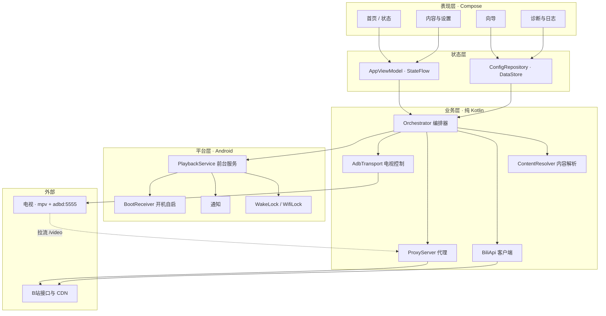
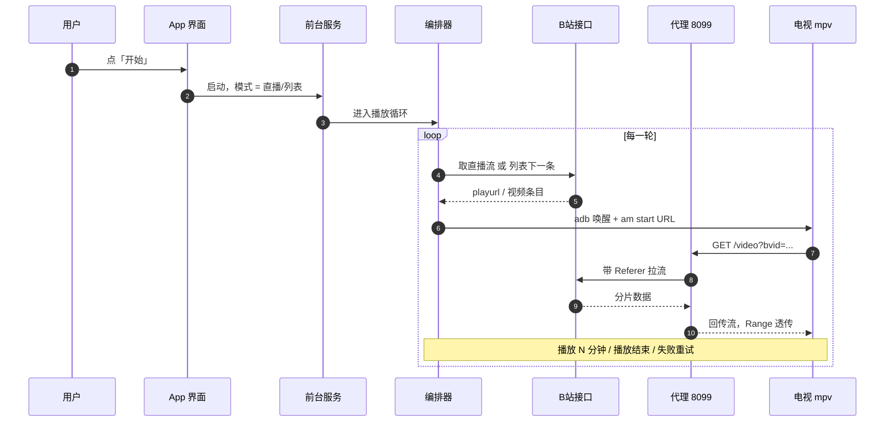
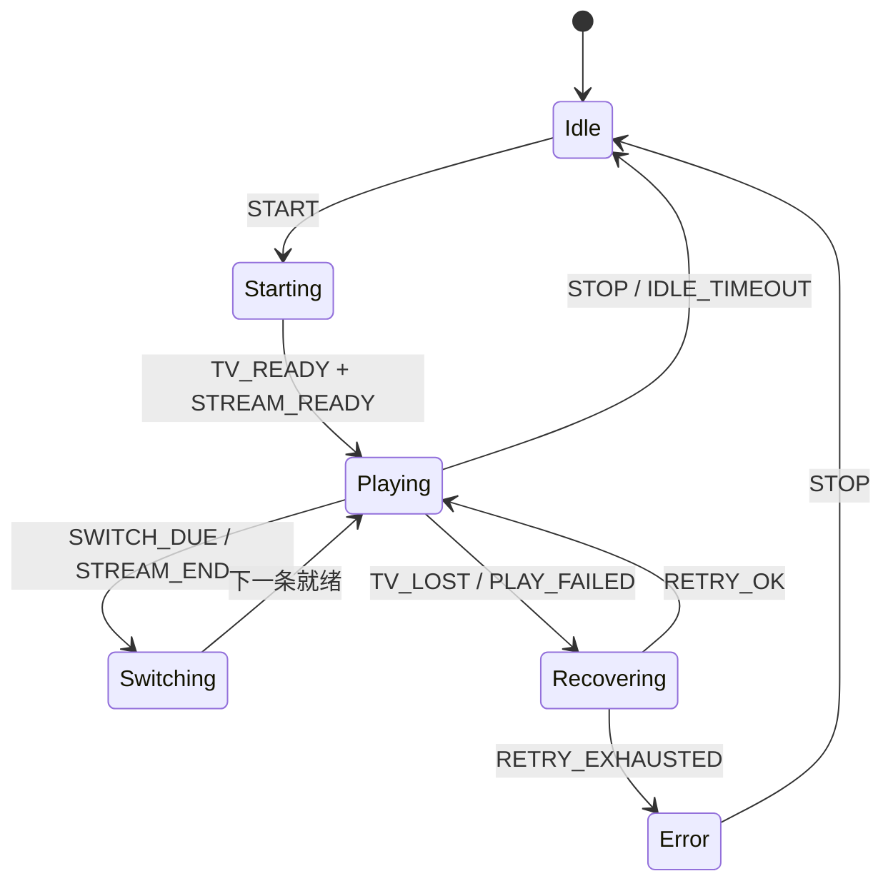

# 安卓播控 App 技术方案

| 项 | 内容 |
| --- | --- |
| 文档编号 | TVAPP-DESIGN-001 |
| 版本 | v1.0 |
| 日期 | 2026-11-09 |
| 状态 | 待评审 |
| 运行平台 | 安卓手机（基准机：一加 Ace 3 / Android 14） |
| 显示终端 | 电视 + mpv-android（adb 端口 5555） |
| 信号链路 | B站 CDN → 手机 App（代理）→ WiFi → 电视 mpv → HDMI |

> 阅读提示：本文面向新接手的开发人员。第 1 章说明做什么，第 4、5 章说明怎么实现，第 9、10 章说明先验证什么、按什么顺序做。架构图的可视化版本见 `docs/arch/index.html`。

## 目录

1. 概述
2. 需求规格
3. 设计原则
4. 系统架构
5. 核心设计
6. 接口设计（留空）
7. 运行环境
8. 非功能实现
9. 待验证项
10. 实施计划
11. 风险登记册
12. 运维与可观测性
13. 附录

---

# 1. 概述

## 1.1 这个 App 是干什么的

**一句话**：一个装在安卓手机上的播控 App——把 B 站的直播和视频，经手机中转后投到电视上播放，并按设定自动轮换，不用碰电视遥控器。

## 1.2 它从哪来

| 阶段 | 形态 | 状态 |
| --- | --- | --- |
| 一代 | 树莓派 + Python，HDMI 直连电视 | 已跑通 |
| 二代 | 安卓手机 + Termux 跑同一套 Python | 已跑通，实测直播/录播都流畅 |
| 三代（本项目） | 把二代逻辑做成原生 App | 本次要做 |

二代已经证明**业务逻辑是对的**，本项目只解决“宿主”——不用装 Termux、不用敲命令、开机自动跑。

## 1.3 目标（四条验收线）

1. 装完配置一次，之后点「开始」就能看。
2. 直播、视频列表两种模式都能轮播。
3. 手机重启后，常驻模式能自己恢复。
4. 出问题时，能在 App 里看到原因，不用连电脑。

## 1.4 不做什么

不做录像/下载、不做弹幕、不做多台电视、不做 iOS/Windows 端。这些都不在本期范围。

---

# 2. 需求规格

## 2.1 功能需求

| 编号 | 需求 | 优先级 | 验收标准 |
| --- | --- | --- | --- |
| FR-01 | 配置电视地址（IP:5555）并测试连接 | P0 | 点「测试」返回设备在线；失败给出原因 |
| FR-02 | 配置内容源：直播间列表 或 视频列表链接 | P0 | 保存后重启 App 仍在，且能读到 |
| FR-03 | 直播模式轮播 | P0 | 按列表依次播放；未开播的房间自动跳过 |
| FR-04 | 录播模式轮播 | P0 | 列表第一个播完，自动播下一个，循环 |
| FR-05 | 切换间隔可配置 | P0 | 到达设定秒数或视频播完时触发切换 |
| FR-06 | 投屏：唤醒电视 + 启动 mpv + 递流地址 | P0 | 电视亮屏并开始播放 |
| FR-07 | 停止播放 | P0 | 点停止后 5 秒内电视停播 |
| FR-08 | 手机端代理服务（8099） | P0 | 电视能通过手机拉流，1080p 不卡 |
| FR-09 | 链接识别：直播间 / 列表 / 合集 / UP 空间 | P0 | 粘贴后自动判类型；合集识别后给出引导提示（本期不支持合集轮播）；其他不支持类型给出明确提示 |
| FR-10 | 按需模式：空闲自动停 | P0 | 持续 N 分钟（可配）无播放任务后自动停止（播放中不触发） |
| FR-11 | 常驻模式：开机自启 + 崩溃自恢复 | P1 | 重启手机后 2 分钟内自动恢复播放 |
| FR-12 | 前台服务通知 | P1 | 通知栏显示当前状态，带「停止」按钮 |
| FR-13 | 首次配置向导 | P0 | 5 步内完成，中途退出可续；手机 IP 自动获取失败时可手动填写 |
| FR-14 | 设置修改 | P0 | 改完下次播放生效，不用重装 |
| FR-15 | 诊断页 | P1 | 电视可达 / mpv 已装 / B站可达 / 端口占用，逐项给结论 |
| FR-16 | 权限引导 | P1 | 缺权限时给出一键跳转设置页 |
| FR-17 | 日志查看 | P2 | 可看最近 200 条，可导出分享 |
| FR-18 | 异常自愈 | P1 | 断网 30 秒恢复后自动续播，不需人手点 |
| FR-19 | 端口冲突处理 | P2 | 8099 被占用时提示换端口并保存 |

## 2.2 非功能需求

| 编号 | 需求 | 指标 | 怎么测 |
| --- | --- | --- | --- |
| NFR-01 | 冷启动到可播放 | ≤ 10 秒 | 杀进程后点「开始」计时 |
| NFR-02 | 常驻内存 | ≤ 150 MB | 播放 1 小时后看内存 |
| NFR-03 | 代理转发 CPU | ≤ 5%（单路 1080p） | 播放中看 CPU 占用 |
| NFR-04 | 长稳 | 连续 72 小时不崩、不泄漏 | 常驻模式挂 3 天 |
| NFR-05 | 兼容性 | Android 10–15，targetSdk 35 | 至少 2 台真机验证 |
| NFR-06 | 转发延迟 | 相比直连增加 ≤ 200 ms | 对比首帧时间 |
| NFR-07 | 安装包 | ≤ 20 MB | 看 APK 大小 |
| NFR-08 | 隐私 | 数据只存本机，不上传 | 抓包确认无第三方上报 |

## 2.3 用户场景

| 场景 | 用户动作 | 期望结果 |
| --- | --- | --- |
| 首次配置 | 装 App → 向导 5 步 → 点开始 | 电视开始播放，配置被记住 |
| 日常开看 | 打开 App → 点开始 | 3 秒内电视出画面 |
| 临时停止 | 点停止 / 通知栏停止 | 电视停播，App 留在后台待命 |
| 手机重启 | 不做任何操作（常驻模式） | 解锁后自动恢复播放 |
| 网络中断 | 不操作 | 恢复后自动续播，日志记录一次失败 |
| 换内容 | 设置里改链接 → 保存 | 下一次切换时用新内容 |

---

# 3. 设计原则

这六条是给后续开发看的“硬约束”，遇到分歧按这里裁决。

| # | 原则 | 含义 | 为什么 |
| --- | --- | --- | --- |
| 1 | **单一状态源** | 播放状态只在本机状态机上，UI、通知、日志都从它读 | 避免“界面显示在播、实际早断了” |
| 2 | **接口隔离、可替换** | `BiliApi`、`AdbTransport`、`ProxyServer` 都是接口，实现可换 | adb 有降级方案，B站接口会变 |
| 3 | **失败必须可见** | 不许空 catch；所有失败进日志 + 状态 + 用户提示 | Python 版踩过“静默失败”的坑 |
| 4 | **不抢控制权** | 用户手动关电视/停播后，系统不自动抢回 | 这是产品底线，不是技术选择 |
| 5 | **能降级就降级** | 镜像失败换源、adb 失败换通道、端口冲突换端口 | 家庭网络不稳定，硬失败体验差 |
| 6 | **单进程、零外部服务** | 不依赖 Termux、不依赖 adb server、不依赖电脑 | 这就是本项目的初衷 |

---

# 4. 系统架构

## 4.1 总体架构

App 是**单进程**的，分四层，依赖只朝一个方向：上层依赖下层，下层不认识上层。



## 4.2 组件职责

| 组件 | 职责 | 关键类 | 不做什么 |
| --- | --- | --- | --- |
| UI | 展示状态、收集配置、触发开始/停止 | `HomeScreen`、`SetupScreen` | 不直接调网络和 adb |
| `AppViewModel` | 把状态机状态映射成界面状态 | `AppViewModel` | 不含业务逻辑 |
| `ConfigRepository` | 读写配置、校验格式 | `ConfigRepository` | 不判断业务 |
| `Orchestrator` | 状态机 + 轮播调度 | `Orchestrator` | 不关心界面 |
| `ContentResolver` | 链接识别、内容展开成播放队列 | `ContentResolver` | 不发起播放 |
| `BiliApi` | 取流地址、房间状态、列表 | `BiliApi`、`WbiSigner` | 不转发媒体数据 |
| `ProxyServer` | 对电视提供 `/video` 流 | `ProxyServer` | 不决策播什么 |
| `AdbTransport` | 控制电视（唤醒/播放/停止） | `DadbTransport` | 不碰媒体 |
| `PlaybackService` | 前台服务载体、锁、通知 | `PlaybackService` | 不写业务逻辑 |
| `Diagnostics` | 环境自检 | `Diagnostics` | 只读 |
| `Logger` | 环形日志 + 文件落盘 | `LogBus` | 不阻塞主流程 |

## 4.3 部署视图

关键是**两条通道方向相反**，开发时最容易搞混：

```
控制通道（手机 → 电视，TCP 5555）
  手机 App ──adb 命令──▶ 电视 adbd ──▶ mpv 启动/停止/唤醒

媒体通道（电视 → 手机，HTTP 8099）
  电视 mpv ──GET /video──▶ 手机代理 ──HTTPS──▶ B站 CDN
```

| 项 | 值 |
| --- | --- |
| 手机角色 | 媒体中转 + 控制端 |
| 电视角色 | 播放端，只认手机地址 |
| 网络前提 | 手机与电视同一局域网 |
| 电视需要 | mpv-android（`is.xyz.mpv`）+ 开启 5555 网络调试 |
| 手机对外地址 | 电视用到的 `http://<手机IP>:8099` |

## 4.4 线程与并发模型

App 最容易出 bug 的地方是并发，这里定死规则：

| 场景 | 线程/调度器 | 规则 |
| --- | --- | --- |
| Compose 渲染 | Main | 只做 UI，不阻塞 |
| B站请求、adb 命令 | IO | 全部显式超时 |
| 代理转发 | 每路一个协程 | 最多 3 路并发 |
| 状态机 | 单协程 + 事件队列 | **串行消费事件，禁止并发改状态** |
| adb 命令 | `Mutex` 串行 | 同一时刻只有一条命令在跑 |
| 配置读写 | IO | DataStore 自带线程安全 |

**状态机用 actor 模式**：所有事件投进 `Channel`，由一个协程顺序处理。这样不用加锁也不会出现竞态——这是整个 App 稳定性的地基。

---

# 5. 核心设计

先看一次播放的完整链路，后面各节都是它的局部展开：

1. 用户点「开始」→ 状态机收到 `START` → 进入 `Starting`
2. `ContentResolver` 把配置内容展开成播放队列
3. 取队首，`BiliApi` 拿流地址（直播拿房间流，录播按 bvid 拿 MP4 地址）
4. `AdbTransport` 唤醒电视、拉起 mpv、把 `http://手机IP:8099/video?...` 递过去
5. 电视 mpv 反过来向手机 8099 发请求
6. `ProxyServer` 补 Referer/UA 后向 B站拉流，边收边转
7. 到切换时间或播放结束 → `Switching` → 回到第 3 步
8. 任何环节失败 → `Recovering` → 重试或跳到下一个



## 5.1 内容解析（ContentResolver）

**输入**：用户粘的一串东西。**输出**：`Content`（类型 + 标题 + 播放项列表）。

| 输入形态 | 判定方式 | 处理 |
| --- | --- | --- |
| `live.bilibili.com/<room>` | 正则命中 | `room_init` 换成真实 room_id，标为「直播间」 |
| `space.bilibili.com/<mid>/lists/<id>` | 正则命中后**必须调接口验证** | 先查 `series/archives`；`total>0` 才是列表；返回 -404 再查 `seasons_archives_list` 判合集 |
| `bilibili.com/video/BV...` | 正则命中 | 单条视频 |
| 纯数字 / 纯 BV 号 | 正则命中 | 同上，自动补全 |
| `space.bilibili.com/<mid>` | 正则命中 | 取该 UP 的投稿列表（可选功能） |

**必须注意的坑**：`/lists/<id>` 这个 URL 形状，合集和列表**完全一样**，只有调接口才知道是哪种。Python 版当年就是没验证、直接按列表处理，导致合集链接永远返回空。

失败提示要说人话：

| 情况 | 提示 |
| --- | --- |
| 合集链接 | 「这是合集，暂不支持；请到 UP 空间选『列表』再复制链接」 |
| 列表为空 | 「这个列表里没有可播放的视频」 |
| 网络失败 | 「连不上 B站，检查手机网络」 |

## 5.2 媒体代理（ProxyServer）

**接口**

| 路径 | 用途 | 是否支持 Range |
| --- | --- | --- |
| `GET /video?bvid=...&qn=80` | 录播文件 | 支持，透传 |
| `GET /live?room=...` | 直播流 | 不支持（无总长度） |
| `GET /status` | 健康检查 | — |

**一次转发的流程**

1. 收到电视请求 → 校验参数 → 查本地流地址缓存（有效期 30 分钟）
2. 缓存没有就调 `BiliApi` 取 `playurl`（带 wbi 签名）
3. 选定 host：主地址 → 失败换镜像（B站返回的 `durl` 里有多个 host）
4. 建上游连接，**逐块转发**，内存缓冲 32–64 KB，**不落盘**
5. 客户端断开 → 立刻断开上游，释放资源

**必须补齐的请求头**

```
Referer: https://www.bilibili.com/
User-Agent: <桌面 Chrome UA>
Origin:  https://www.bilibili.com
```

少任何一个，B站 CDN 大概率返回 403。这是手机代理存在的**唯一理由**，比转发本身更重要。

**边界处理**

| 情况 | 处理 |
| --- | --- |
| 客户端带 `Range` | 透传给上游；上游返 206 就原样回 206 + `Content-Range` |
| 上游 30 秒无数据 | 断开、重连一次、仍失败返回 502 |
| 镜像 403 | 换下一个 host，最多 3 个 |
| 端口被占用 | 启动失败 → 状态 `Error` → 提示改端口 |
| 电视中途断开 | 不报错，记日志，等下次请求 |

## 5.3 adb 控制（AdbTransport）

**接口**：`connect()`、`wake()`、`play(url)`、`stop()`、`isPlaying()`、`state()`

**实现一：dadb**（首选）

| 命令 | 用途 |
| --- | --- |
| `input keyevent 224` + `wm dismiss-keyguard` | 点亮屏幕并解锁 |
| `am start -a android.intent.action.VIEW -n is.xyz.mpv/.MPVActivity -d '<url>'` | 拉起 mpv 播放 |
| `am force-stop is.xyz.mpv` | 停止播放 |
| `dumpsys media_session` | 判断是否在播 |

要点：

- **密钥持久化**：dadb 用自己的 RSA 密钥，存在 App 私有目录。首次连接电视会弹「允许调试」，用户点一次后永久有效。密钥丢失 = 要重新授权，所以别放缓存目录。
- **串行执行**：所有命令过一个 `Mutex`，避免并发把 adbd 搞挂。
- **超时**：每条命令 8 秒，超时视为电视失联。
- **不常驻连接**：dadb 不需要 adb server，每次命令新建 TCP，用完即关。

**实现二：打包 adb 二进制（降级）**

只有当 dadb 在目标电视上不通时才启用：把 `adb` 编译成 `lib/arm64-v8a/libadb.so`，用 `ProcessBuilder` 执行，行为与 Termux 里完全一致。代价是包体 +6~9 MB、要自己管 server 生命周期。

**这就是把 adb 做成接口的原因**——上层编排器一行都不用改。

## 5.4 播放编排（Orchestrator）

**播放队列**

```kotlin
data class PlayItem(
    val kind: Kind,        // LIVE / VIDEO
    val id: String,        // roomId 或 bvid
    val title: String,
    val durationSec: Int?  // 直播为 null
)
```

**两种模式的差异**

| | 直播模式 | 录播模式 |
| --- | --- | --- |
| 队列来源 | 配置的直播间列表 | 列表接口返回的视频 |
| 是否可播 | 每次切换前查 `live_status` | 总是可播 |
| 切换时机 | 到固定间隔（如 30 分钟） | 视频播完 或 到间隔 |
| 全部不可播 | 每 60 秒重查一次，不退出 | 回到队首循环 |

**主循环（伪代码）**

```kotlin
suspend fun run(content: Content) {
    val queue = content.toQueue()
    while (state.isActive) {
        val item = queue.next()
        if (!item.isAvailable()) { delay(1_000); continue }
        tv.wakeIfNeeded()
        tv.play(proxyUrl(item))          // 幂等：同一 URL 不重复拉起
        val ok = awaitSwitch(item)        // 到时 / 播完 / 失败
        if (!ok) failures++ else failures = 0
        if (failures >= 3) continue       // 连续失败就跳下一个
    }
}
```

**失败策略**：单条失败重试 1 次 → 仍失败跳到下一条 → 整队列连续 3 次失败 → 状态 `Error`，通知里给「重试」按钮。

## 5.5 运行模式

| | 按需模式 | 常驻模式 |
| --- | --- | --- |
| 启动 | 用户点「开始」 | 开机自启；解锁后自动恢复上次播放状态（上次为播放中时）；点「开始」仅用于首次启动或手动恢复 |
| 停止 | 点停止，或连续 N 分钟无播放任务 | 只有用户点停止 |
| 看门狗 | 不需要 | 每 60 秒检查，异常自愈 |
| 耗电 | 低 | 高，建议常插电 |
| 适用 | 想起来才看 | 电视当背景屏 |

**实现**：同一个 `PlaybackService`，靠 `mode` 字段区分行为。模式本身存进配置，开机恢复上次模式。

## 5.6 状态机



| 事件 | 触发方 |
| --- | --- |
| `START` / `STOP` | 用户、通知按钮 |
| `TV_READY` | AdbTransport 连接成功 |
| `STREAM_READY` | ProxyServer 首包到达 |
| `SWITCH_DUE` | 定时器 |
| `STREAM_END` | mpv 停止 / 播放结束检测 |
| `TV_LOST` | adb 超时或 `pidof` 失败 |
| `RETRY_OK` / `RETRY_EXHAUSTED` | 重试逻辑 |
| `IDLE_TIMEOUT` | 按需模式空闲计时：连续 idleMinutes 无播放任务（播放中不触发） |

**规则**：UI、通知、日志全部从 `State` 读，任何组件都不得自己维护一份「我在播放」的布尔值。

**用户主动停止 vs 异常丢失（原则 4「不抢控制权」）**：`STOP` 后进入 `Idle`，看门狗与自愈逻辑**不得**对 `Idle` 生效——用户手动停播即尊重，不自动抢回。只有异常丢失（`TV_LOST` / `PLAY_FAILED`）才触发自动恢复；恢复设上限（连续 3 次）与冷却（间隔 ≥60 秒；电视长时间关机时快速耗尽），超限进 `Error`，等用户点「重试」。

## 5.7 配置与向导

| 配置项 | 默认 | 校验 |
| --- | --- | --- |
| `tvHost` / `tvPort` | 空 / 5555 | IP 或主机名 + 端口 1–65535 |
| `phoneIp` | 自动探测，失败可手填 | 合法 IPv4；与电视同网段，否则提示 |
| `mpvPackage` | `is.xyz.mpv` | 非空 |
| `proxyPort` | 8099 | 1024–65535 且未被占用 |
| `mode` | `live` | 枚举 |
| `switchSeconds` | 1800 | 60–86400 |
| `idleMinutes` | 10 | 1–240 |
| `rooms[]` / `listUrl` | 空 | 至少一项 |

**向导 5 步**：手机网络 → 电视连接 → 播放器 → 内容 → 自检完成。每步都能返回上一步，进度存在配置里，中断可续。第 1 步先自动获取手机 IP，失败时切换为手动输入（字段校验见上表），不允许空着进入下一步。

**生效时机**：配置改完不立即打断播放，下一次切换时生效（避免用户改个间隔就把正在看的节目掐了）。

## 5.8 保活与自愈

这是 App 方案里**唯一比 Python 版更麻烦**的部分，因为 Termux 有 `sv` 和 `termux-wake-lock`，App 得自己实现。

**四件套**

| 机制 | API | 说明 |
| --- | --- | --- |
| 前台服务 | `startForeground` | 类型建议 `dataSync`；若被限制改 `specialUse` 并在清单里写理由 |
| 唤醒锁 | `PowerManager.PARTIAL_WAKE_LOCK` | 保证 CPU 不休眠 |
| WiFi 锁 | `WifiManager.WIFI_MODE_FULL_HIGH_PERF` | 防止息屏后 WiFi 降速 |
| 电池白名单 | `ACTION_REQUEST_IGNORE_BATTERY_OPTIMIZATIONS` | 需用户手动同意 |

**手机息屏不影响播放**：`PARTIAL_WAKE_LOCK` 只保 CPU、不点亮屏幕；`WifiLock` 保证息屏后 WiFi 不断流；电视端 `input keyevent 224` 点亮的是电视自己的屏幕，与手机屏幕无关。

**看门狗**：每 60 秒检查三件事——服务活着、代理端口在听、状态机未卡在异常（`Error` 为终态，等用户「重试」，不自动拉起）。任一异常按“重启服务 → 重连电视 → 重启 mpv”的顺序自愈；`Idle`（用户主动停止）不纳入自愈范围，异常丢失的恢复上限与冷却见 5.6。

**厂商设置引导**（代码无法替代）：给 ColorOS / HyperOS / OriginOS 分别提供跳转入口，引导用户开「自启动」「后台耗电不限制」「任务锁定」三项。

**开机恢复的限制**：Android 直接启动模式（Direct Boot）下，用户首次解锁前收不到完整的 `BOOT_COMPLETED`。所以真实的启动时机是**用户解锁手机之后**，这点要写进用户手册，避免误解为“一开机就播”。

---

# 6. 接口设计（留空）

> 本章不预先定义，由开发在实现过程中补充。写代码时每确定一个接口，就回来填一行，最后本章自然成为“接口清单”。

**建议的填写格式**（开发照这个表填即可）：

| 接口 / 类 | 方法签名 | 输入 | 输出 | 错误 | 备注 |
| --- | --- | --- | --- | --- | --- |
| `BiliApi` | `suspend fun playUrl(bvid: String, qn: Int): Stream` | bvid、清晰度 | 流地址 + host 列表 | `BiliException` | 带 wbi 签名 |
| `AdbTransport` | `suspend fun play(url: String)` | 完整 URL | — | `TvUnreachable` | 幂等 |
| `ProxyServer` | `GET /video?bvid=` | bvid、Range | 视频字节流 | 502/403 | 透传 Range |
| … | … | … | … | … | … |

**两条约定**（免得后面接口对不上）：

1. 所有网络与 adb 方法都是 `suspend`，超时在实现内部定，调用方不传。
2. 错误统一抛 `AppException` 子类，带 `code`（枚举）和 `userMessage`（中文，可直接显示）。

---

# 7. 运行环境

## 7.1 手机侧

| 项 | 要求 | 说明 |
| --- | --- | --- |
| 系统版本 | Android 10（API 29）及以上 | targetSdk 35；基准机为 Android 14 |
| 基准设备 | 一加 Ace 3（ColorOS 14） | 其余机型按 8.4 矩阵验证 |
| 权限 | 通知、电池优化豁免 | 首启时引导申请 |
| 存储 | 无需外部存储 | 日志、配置都在 App 私有目录 |
| 内存 | 可用 500 MB 以上 | 常驻占用约 80–150 MB |
| 供电 | 常驻模式建议插电 | 长时间息屏网络转发 + 常驻 CPU，耗电明显（息屏不影响播放） |

## 7.2 电视侧

| 项 | 要求 | 说明 |
| --- | --- | --- |
| 播放器 | mpv-android，包名 `is.xyz.mpv` | 需侧载安装，Activity 为 `is.xyz.mpv/.MPVActivity` |
| 调试通道 | 开启「网络调试 / ADB」，端口 5555 | 首次连接电视会弹授权，用户点「允许」 |
| 网络 | 与手机同一局域网 | 不能跨网段、不能走访客网络 |
| IP | **建议在路由器里给电视绑定固定 IP** | DHCP 换 IP 是“第二天连不上”的头号原因 |
| 解码 | 支持 1080p H.264 硬解 | 4K 不保证，本期不做 |

> 电视的 ADB 调试开关在部分机型重启后会关闭，属于电视侧限制，App 侧只能提示、不能代开。

## 7.3 网络要求

| 项 | 要求 | 失败表现 |
| --- | --- | --- |
| 同子网 | 手机与电视在同一网段 | adb 连不上 |
| 关 AP 隔离 | 路由器关闭「访客网络隔离」 | 能连 WiFi 但互不可达 |
| 带宽 | 稳定 8 Mbps 以上（1080p） | 卡顿、花屏 |
| 频段 | 优先 5 GHz | 2.4 GHz 在人多时抖动明显 |
| 手机 IP | 建议固定，或 App 启动时自动刷新 | 电视拉流地址失效 |

**注意**：媒体数据是「手机收一份、发一份」，所以路由器到手机这一跳要承载双倍流量。

## 7.4 开发与环境依赖

| 项 | 版本 | 备注 |
| --- | --- | --- |
| JDK | **17** | AGP 8.x 要求；本机现有 JDK 25 不兼容，需单独装 17 |
| Android Studio | Ladybug 或更新 | 或用命令行 SDK + Gradle |
| AGP / Gradle | 8.5+ / 8.7+ | 与 JDK 17 配套 |
| Kotlin | 2.0+ | 协程、Compose 编译器 |
| Compose BOM | 最新稳定版 | UI |
| OkHttp | 4.12+ | 上游拉流、流式响应 |
| Ktor Server（CIO） | 3.x | 本地 8099 代理；也可换 NanoHTTPD，但流式支持弱 |
| dadb | 最新稳定版 | 纯 Kotlin ADB 客户端 |
| DataStore | 1.1+ | 配置持久化 |
| minSdk / targetSdk / compileSdk | 29 / 35 / 35 | 与 7.1 一致 |

**分发方式**：自签名 APK 侧载，不上应用商店。签名密钥单独保管，升级必须用同一密钥，否则无法覆盖安装。

---

# 8. 非功能实现

## 8.1 性能预算

| 指标 | 目标 | 主要来源 |
| --- | --- | --- |
| 常驻内存 | ≤ 150 MB | Compose 界面 + OkHttp 连接池 + 32–64 KB 转发缓冲 |
| 代理 CPU | ≤ 5% | 只做字节转发，不转码 |
| 流量 | ≈ 2 × 视频码率 | 手机收 + 发 |
| 首帧时间 | ≤ 3 秒 | 缓存流地址 + 预连接 |
| 日志占用 | ≤ 5 MB | 环形保留最近 2000 条 |

## 8.2 稳定性设计

**重试策略**（全部走指数退避，避免把 B站 或电视打挂）：

| 场景 | 重试次数 | 间隔 | 失败后 |
| --- | --- | --- | --- |
| B站接口请求 | 2 | 1s / 3s | 报错进 `Error` |
| 上游拉流断开 | 2 | 2s / 5s | 换镜像 host |
| adb 命令超时 | 1 | 3s | 标记电视失联，进 `Recovering` |
| 单条内容播放失败 | 1 | 5s | 跳到下一条 |
| 整队列连续失败 | 3 次 | 60s | 进 `Error`，通知给「重试」 |

**降级链**：主镜像 → 备镜像 → 低清晰度 → 报错。每一级都记日志，用户能看到“现在用的是降级方案”。

## 8.3 安全与隐私

| 项 | 做法 |
| --- | --- |
| 数据存储 | 全部在 App 私有目录，不写公共存储 |
| 网络上报 | 无第三方 SDK、无统计、无崩溃上报（除非用户主动导出日志） |
| 日志脱敏 | 只记房间号 / BV 号 / 状态码，不记 Cookie、不记完整 URL 里的签名参数 |
| adb 密钥 | 存私有目录；有条件的可用 Android Keystore 加密 |
| 局域网暴露 | 8099 只监听局域网，不做公网映射；不提供鉴权（局域网内可访问，属已知取舍） |
| APK 签名 | 自签名，密钥离线保管 |

## 8.4 兼容性矩阵

| 维度 | 覆盖范围 | 验证方式 |
| --- | --- | --- |
| Android 版本 | 10 / 12 / 14 / 15 | 至少 2 台真机 |
| 厂商 | ColorOS、HyperOS、OriginOS、原生 | 各测一次后台保活 |
| 电视系统 | Android 6–14 的智能电视 | 基准 1 台，其余按反馈 |
| 播放器 | mpv-android 最新版 | 版本差异只影响 Activity 名 |
| 网络 | 2.4G / 5G、单路由 / Mesh | 各测一次卡顿率 |

**兼容性结论的写法**：不要写“支持”，写“在 X 上验证通过 / 未验证”。这是给后来人看的，别留下假承诺。

---

# 9. 待验证项

本章列出**方案成立前必须实测确认**的问题。原则：没测过的，不许在文档和对用户的说明里写“支持”。

## 9.1 验证清单

| 编号 | 待验证项 | 为什么关键 | 验证方法 | 判定标准 | 优先级 |
| --- | --- | --- | --- | --- | --- |
| **V-01** | dadb 能否连上目标电视并执行命令 | 连不上，整个 adb 方案要换 | App 内置一个调试入口，连接 `电视IP:5555`，依次执行 `getprop ro.build.version.release`、`input keyevent 224`、`pidof is.xyz.mpv` | 三条命令都有正常返回；电视出现一次授权弹窗并点允许后不再弹 | **P0，先做** |
| **V-02** | `am start` 能否拉起 mpv 并播放指定 URL | 这是投屏的唯一入口 | 电视装好 mpv，执行 `am start -a android.intent.action.VIEW -n is.xyz.mpv/.MPVActivity -d 'http://手机IP:8099/video?bvid=...'` | 电视 3 秒内进入播放画面 | **P0，先做** |
| **V-03** | 代理长连接稳定性 | 决定能不能连续看几小时 | 连续播放 1080p 视频 2 小时，中途拖动进度 5 次 | 不中断、不花屏；内存无持续增长 | P0 |
| **V-04** | B站 `playurl` 在 Android 网络下的可用性 | 风控/签名随时可能变 | 用 App 内同一套 wbi 签名请求 20 个不同视频 | 成功率 100%，镜像 host 至少 2 个可用 | P0 |
| **V-05** | ColorOS 后台保活 | 息屏后被杀 = 不可用 | 常驻模式播放，锁屏 2 小时，期间用其他 App | 回来后仍在播；日志无中断 | **P1，高风险** |
| **V-06** | 开机自启时序 | 用户预期“开机就播” | 重启手机，不解锁等 60 秒，再解锁 | 解锁后 2 分钟内自动恢复；不解锁时明确处于等待态 | P1 |
| **V-07** | 手机双倍流量的实际瓶颈 | 可能卡在这里 | 播放中看手机 WiFi 吞吐与 CPU | 1080p 稳定播放，CPU ≤ 5%，无丢帧 | P1 |
| **V-08** | 电视 IP / 手机 IP 变化后的恢复 | 家庭 DHCP 很常见 | 手动改路由器 DHCP 让 IP 变，重启 App | 能自动发现并提示更新，不用重装 | P1 |
| **V-09** | 电池优化豁免在各厂商的实际效果 | 决定通知和保活文案 | 在 ColorOS / HyperOS / OriginOS 各试一次 | 记录哪些机型豁免后仍会被杀 | P2 |
| **V-10** | 频繁切台时 mpv 是否残留 | 长时间跑会 OOM | 每 60 秒切一次台，连续 100 次 | 电视端 mpv 进程数始终为 1，内存平稳 | P2 |
| **V-11** | Android 15 的前台服务类型限制 | 新系统可能起不来服务 | 在 Android 15 真机上启动服务 | `startForeground` 不抛 `ForegroundServiceStartNotAllowedException` | P2 |
| **V-12** | 低端电视的缓冲与卡顿 | 影响体验下限 | 用一台 2 GB 内存的老电视播放 | 记录首帧时间与卡顿次数 | P2 |

## 9.2 验证排期

| 阶段 | 验证项 | 目的 |
| --- | --- | --- |
| **开工第一天** | V-01、V-02 | 这两条不过，方案要改，越早发现越好 |
| M2（直播能播） | V-03、V-04、V-07 | 确认媒体链路 |
| M4（保活） | V-05、V-06、V-08 | 确认常驻可用 |
| 收尾 | V-09 ~ V-12 | 补齐兼容性结论 |

## 9.3 记录要求

每验一项，按下面格式记一条，最后汇总进 `E-实测记录` 类文档：

```
V-01 dadb 连通性
日期：2026-11-10
设备：一加 Ace 3（Android 14）/ 电视型号 + Android 版本
方法：App 调试入口连接 192.168.1.50:5555，执行 3 条命令
结果：通过 / 失败
证据：截图 + 日志片段
结论：可用；首次授权后密钥持久化正常
```

## 9.4 兜底方案

如果 V-01 失败（dadb 连不上），按顺序尝试：

1. 确认电视开的是「网络调试 5555」而不是「无线调试配对」——后者需要配对码，dadb 支持情况待查。
2. 换 dadb 版本，或改用 `AdbLib` 等替代库。
3. 降级到「打包 adb 二进制」方案（见 5.3），功能等价，代价是包体 +6~9 MB。
4. 仍不行则放弃 adb，改为电视端装一个接收端 App（工作量和风险都上一个台阶，需重新评估）。

**这四个台阶要写清楚，是为了让接手的人知道“卡住时往哪退”，而不是推倒重来。**

---

# 10. 实施计划

## 10.1 总体节奏

分三档推进，**每一档都是可交付、可使用的状态**，不追求一次做完。

| 档位 | 内容 | 人日 | 覆盖里程碑 |
| --- | --- | --- | --- |
| **MVP** | 能配、能播、能停 | 12–15 | M0–M3（精简） |
| **可用版** | 加常驻、诊断、权限引导 | 24–28 | M0–M5 |
| **完整版** | 再加遥控界面、定时启停等 P2 | 31–35 | 全部 |

## 10.2 里程碑

| 里程碑 | 目标 | 主要工作 | 交付物 | 验收标准 | 人日 |
| --- | --- | --- | --- | --- | --- |
| **M0** 可行性 | 证明技术路线成立 | 装 JDK 17 + Android Studio；建空工程跑真机；接 dadb 验证 V-01；验证 V-02 | 一个能连电视、能拉起 mpv 的调试 App | 电视弹出授权、mpv 能被拉起播放 | 2 |
| **M1** 骨架 | 服务能起来、界面能显示 | 工程结构、ConfigRepository、前台服务 + 通知、代理骨架 `/status`、状态机壳、主界面 | 点按钮能起服务，界面显示「空闲」 | 服务存活 30 分钟不被杀；通知正常 | 3–4 |
| **M2** 直播 | 电视能播直播 | BiliApi + wbi、直播流解析、`/live` 转发、adb 控制完整实现、直播轮播 | 能从列表里选中直播间，电视播出 | 连续播放 30 分钟不中断；切台正常 | 5–6 |
| **M3** 录播 | 列表能轮播 | 链接识别（含合集判型）、列表接口、`/video` + Range、录播轮播、播放结束检测 | 粘贴列表链接能自动轮播；粘贴合集链接给出引导提示 | 连续播 3 个视频自动切换；拖动进度正常 | 4–5 |
| **M4** 常驻 | 长期免维护 | 按需/常驻模式、BootReceiver、看门狗、权限引导、诊断页、真机保活调优 | 重启手机能自动恢复；诊断页给结论 | 重启后 2 分钟内恢复；锁屏 2 小时仍在播 | 5 |
| **M5** 收尾 | 能交付给人用 | 异常文案、完整回归、签名打包、用户手册 | 可安装的 APK + 说明书 | 新用户按手册 15 分钟能跑通 | 4 |

## 10.3 任务分解（可用版，按里程碑）

| 里程碑 | 任务 | 人日 | 备注 |
| --- | --- | --- | --- |
| M0 | 环境搭建（JDK 17、SDK、真机调试） | 0.5 | 本机 JDK 25 需并存安装 |
| M0 | dadb 连通性验证（V-01） | 1.0 | 不过则启动兜底方案 |
| M0 | `am start` 拉起 mpv 验证（V-02） | 0.5 | 顺带确认 Activity 名 |
| M1 | 工程结构 + 依赖 + 基础 DI | 0.5 | 单模块起步，别急着拆多模块 |
| M1 | ConfigRepository + DataStore | 0.5 | 字段见 5.7 |
| M1 | PlaybackService + 通知 + 锁 | 1.0 | 前台服务类型需适配 |
| M1 | ProxyServer 骨架 + `/status` | 1.0 | 先跑通监听与健康检查 |
| M1 | 状态机骨架（Channel actor） | 0.5 | 只做 Idle/Starting/Playing/Idle |
| M2 | BiliApi + wbi 签名 | 1.5 | 最容易反复，留足时间 |
| M2 | 直播流解析与 `/live` 转发 | 1.0 | 补 Referer/UA |
| M2 | AdbTransport 完整实现 | 1.0 | 命令表见 5.3 |
| M2 | 直播轮播编排 + 开播检测 | 1.0 | 未开播跳过 |
| M2 | 联调与问题修复 | 1.0 | 预留，不要压缩 |
| M3 | ContentResolver 链接识别 | 1.5 | 合集仅用于判型并引导，列表用于展开轮播 |
| M3 | 列表接口 + 合集判型 | 1.0 | 列表用于轮播；合集用 `seasons_archives_list` 判型后提示不支持，不展开 |
| M3 | `/video` + Range 透传 | 1.0 | 重点测拖动 |
| M3 | 录播轮播 + 结束检测 | 1.0 | `dumpsys media_session` 判活 |
| M4 | 按需/常驻两种模式 | 1.0 | 同一服务，参数区分 |
| M4 | BootReceiver + 看门狗 | 1.0 | 自愈顺序见 5.8 |
| M4 | 权限引导（通知/电池/自启） | 1.0 | 三家厂商分别跳转 |
| M4 | 诊断页 | 1.0 | 四项检查 |
| M4 | 真机保活调优（V-05、V-06） | 1.0 | 只能靠反复试 |
| M5 | 异常文案与边界处理 | 1.0 | 面向非技术用户 |
| M5 | 完整回归（12 条用例） | 1.5 | 见 10.5 |
| M5 | 签名打包与升级验证 | 0.5 | 同密钥覆盖安装 |
| M5 | 用户手册 | 1.0 | 图文，含厂商设置截图 |

**MVP 的裁剪**：去掉 M4 全部、M1 的状态机与诊断、M2 的联调压缩到 0.5，M3 的合集判型延后（MVP 内粘贴合集链接按不支持类型统一提示）→ 约 14 人日。

## 10.4 关键路径

```
M0 ──▶ M2 ──▶ M3 ──▶ M5
        │
        └──▶ M4（可与 M3 并行，单人则串行）
```

- **关键路径上的只有 V-01**：它不过，M2 之后全要改。
- M1 的骨架可以和 M0 的验证并行做（一个人时串行，两人时可拆）。
- M4 的保活调优不能提前，必须等 M2/M3 有真实播放负载才测得出来。

## 10.5 验收用例（回归清单）

| # | 用例 | 期望 |
| --- | --- | --- |
| 1 | 全新安装 → 向导 5 步 → 开始 | 电视播放 |
| 2 | 直播列表 3 个房间，其中 1 个未开播 | 跳过未开播，播其余 |
| 3 | 录播列表连续播 3 个 | 自动切换，不重复 |
| 4 | 播放中拖动进度（若播放器支持） | 正常定位 |
| 5 | 播放中点停止 | 5 秒内电视停 |
| 6 | 播放中拔网 30 秒后恢复 | 自动续播 |
| 7 | 播放中关闭电视电源 | 进恢复态，不报错崩 |
| 8 | 重启手机（常驻模式） | 解锁后 2 分钟内恢复 |
| 9 | 修改切换间隔 | 下次切换生效，不打断当前 |
| 10 | 粘贴合集链接 | 明确提示不支持，不崩溃 |
| 11 | 8099 被占用时启动 | 提示换端口 |
| 12 | 连续运行 24 小时 | 无崩溃、内存平稳 |

## 10.6 范围控制

1. **任何新需求先问：影响不影响 V-01~V-04？** 影响就先不做。
2. 变更一律「砍 P2 保 P0」，不加人不加时间。
3. 每个里程碑结束做一次演示，演示不过不进下一阶段——避免最后一起爆雷。
4. 文档里的日期只写「里程碑 + 相对周」，不写绝对日期，避免频繁改。

---

# 11. 风险登记册

| 编号 | 风险 | 概率 | 影响 | 等级 | 应对策略 | 触发信号 |
| --- | --- | --- | --- | --- | --- | --- |
| **R-01** | dadb 连不上目标电视 | 中 | 高 | **高** | 预设备选方案：先试其他 ADB 库，再试打包 adb 二进制（见 9.4） | V-01 失败 |
| **R-02** | 厂商后台策略把服务杀掉 | 高 | 高 | **高** | 前台服务 + 看门狗 + 电池白名单引导 | 锁屏后播放中断、日志有断层 |
| **R-03** | B站接口或 wbi 签名变更 | 中 | 高 | **高** | 隔离在 `BiliApi` 之后，改实现不改调用方 | 批量 403 / 412 / 返回空 |
| **R-04** | 电视或手机 IP 变化 | 高 | 中 | 中 | 路由器固定 IP；App 启动时校验并提示 | adb 连接超时 |
| **R-05** | 代理端口被占用 | 中 | 低 | 低 | 启动时探测，提示改端口 | 8099 监听失败 |
| **R-06** | 双倍流量导致卡顿 | 中 | 中 | 中 | 降清晰度、优先 5GHz、减少并发 | 播放卡顿、缓冲频繁 |
| **R-07** | 系统升级破坏前台服务/权限 | 中 | 中 | 中 | 兼容矩阵提前测 Android 15 | 升级后服务起不来 |
| **R-08** | 工期估算偏差 | 高 | 中 | 中 | 里程碑演示、MVP 优先、范围可砍 | M1 延期超过 3 天 |
| **R-09** | 单人开发中断、无人接手 | 中 | 中 | 中 | 文档（本文）、接口留空填补、注释到位 | 无人能讲清 5.4 逻辑 |
| **R-10** | 合规风险（代理 B站内容、局域网暴露） | 低 | 中 | 低 | 仅自用、不公开分发、不做公网映射 | 出现在公网 |

**应对分级**：R-01/R-02/R-03 是“方案级”风险，必须在前两周解决或降级；其余是“工程级”，靠流程消化。

---

# 12. 运维与可观测性

## 12.1 日志

| 项 | 约定 |
| --- | --- |
| 级别 | DEBUG / INFO / WARN / ERROR 四级，默认 INFO |
| 字段 | 时间、级别、模块、事件、关键参数（房间号/BV/状态码）、结果 |
| 存储 | 环形缓冲 2000 条 + 文件保留 5 MB，超出滚动删除 |
| 脱敏 | 不记 Cookie、不记完整签名 URL |
| 导出 | 一键导出为 txt，可分享 |

**必须打日志的节点**：状态迁移、每次切换、每次重试、每次 adb 失败、每次镜像切换。

## 12.2 诊断页

一键跑四项检查，每项给“通过 / 失败 + 一句话原因”：

| 检查 | 方法 | 失败提示 |
| --- | --- | --- |
| 电视可达 | adb `get-state` | 「连不上电视，检查 IP 和调试开关」 |
| 播放器已装 | `pm path is.xyz.mpv` | 「电视没装 mpv-android」 |
| B站可达 | 请求一个公开接口 | 「手机连不上 B站」 |
| 代理端口 | 本地监听测试 | 「端口被占用，换一个」 |

## 12.3 常见故障排查

| 症状 | 可能原因 | 处理 |
| --- | --- | --- |
| 电视黑屏但 adb 通 | mpv 未启动或 Activity 名不对 | 检查 `am start` 返回值；确认包名 |
| 能播但很快卡住 | 上游镜像慢 | 看日志是否发生镜像切换；换清晰度 |
| 第二天连不上 | 电视 IP 变了 | 路由器固定 IP |
| 锁屏后停 | 后台被杀 | 开自启动、关电池限制、任务上锁 |
| 播放正常但无法切台 | 播放结束检测失效 | 检查 `dumpsys media_session` 输出格式 |
| 服务反复重启 | 看门狗误判 | 放宽健康检查阈值，查日志 |

## 12.4 版本与升级

- 始终使用同一签名密钥；配置用 DataStore，升级时做字段兼容（新增字段给默认值）。
- 升级不打断正在播放：安装后由用户手动重启服务。
- 每次发版记录：版本号、变更点、已知问题。

## 12.5 长期维护成本

| 来源 | 频率 | 说明 |
| --- | --- | --- |
| B站接口变化 | 不确定，可能每季度 | 变更集中在 `BiliApi`，单点修复 |
| Android 版本 | 每年 | 前台服务类型、权限收紧 |
| 电视固件升级 | 偶发 | 可能重置 ADB 开关 |
| mpv-android 更新 | 偶发 | 只影响 Activity 名 |

---

# 13. 附录

## A. B站接口清单

| 接口 | 用途 | 要点 |
| --- | --- | --- |
| `x/frontend/finger/spi` | 取 buvid3/buvid4 | 部分接口需要 Cookie |
| `x/web-interface/nav` | 取 wbi 的 img_key / sub_key | 未登录也返回 |
| `x/room_init` | 房间短号换真实 room_id | 直播 |
| `x/player/playurl?platform=html5&qn=80&fnval=0` | 取点播流地址 | 返回 `durl`，单文件 MP4 |
| `x/player/wbi/playurl` | 同上（需 wbi 签名） | 风控更严时用 |
| `x/series/archives` | 列表视频 | `total>0` 才是列表 |
| `x/polymer/web-space/seasons_archives_list` | 合集判型 | 与列表接口互斥；本期仅用于判型并引导，不展开合集轮播 |
| `x/polymer/web-space/seasons_series_list` | UP 的合集/列表索引 | 用于“自动发现” |
| `x/web-interface/view` | 视频详情/所属合集 | 需 buvid cookie，否则 412 |
| `x/web-interface/wbi/search/type` | 搜 UP / 直播间 | 需 wbi 签名 |

**wbi 签名**：取 nav 里的 `img_key`/`sub_key`，按固定重排表生成 `mixinKey`，再把参数排序拼接 + `mixinKey` 做 MD5 得 `w_rid`，附 `wts` 时间戳。实现细节随 B站调整，封装在 `WbiSigner` 单点维护。

## B. adb 命令清单

| 命令 | 用途 |
| --- | --- |
| `adb connect <ip>:5555` | 连接电视 |
| `adb -s <ip>:5555 get-state` | 探活 |
| `shell input keyevent 224` | 点亮屏幕 |
| `shell input keyevent 85` | 播放/暂停 |
| `shell wm dismiss-keyguard` | 解锁屏 |
| `shell am start -a android.intent.action.VIEW -n is.xyz.mpv/.MPVActivity -d '<url>'` | 拉起播放 |
| `shell am force-stop is.xyz.mpv` | 停止播放 |
| `shell pidof is.xyz.mpv` | 是否在运行 |
| `shell dumpsys media_session` | 是否在播放 |
| `shell pm path is.xyz.mpv` | 是否已安装 |
| `shell getprop ro.build.version.release` | 电视系统版本 |

## C. 术语表

| 术语 | 解释 |
| --- | --- |
| 直播流 | 持续产生、无总长度的媒体数据 |
| 点播（录播） | 有固定长度的视频文件，支持 Range 分段请求 |
| Range | HTTP 分段请求，用于拖动进度和断点续传 |
| 代理 | 手机替电视向 B站 取流并转发，顺带补齐鉴权头 |
| 防盗链 | B站 校验 Referer/UA，防止被第三方直接引用 |
| wbi 签名 | B站 网页接口的风控签名参数 |
| adb / adbd | Android 调试桥；adbd 是电视端的守护进程 |
| dadb | 纯 Kotlin 实现的 ADB 客户端，替代 adb 命令行 |
| 前台服务 | Android 中带常驻通知、不易被系统回收的服务 |
| 唤醒锁 / WiFi 锁 | 阻止 CPU 休眠 / WiFi 降速的机制 |

## D. 参考资料

- [A-技术方案-直播间自动投屏系统.md](A-技术方案-直播间自动投屏系统.md)（一代方案，架构思想可对照）
- [C-B站非官方API合集-整理版.md](C-B站非官方API合集-整理版.md)（接口细节）
- [E-实测记录-树莓派播放与硬解.md](E-实测记录-树莓派播放与硬解.md)（实测方法参考）
- [全流程调试手册.md](../debug/全流程调试手册.md)（Termux 版操作对照）
- [架构图 HTML](arch/index.html)（三张图的可视化版本）
