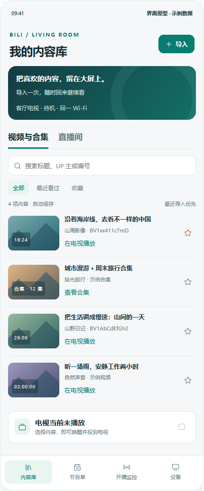

# 三代 App 前端效果与操作说明

更新时间：2026-11-16。

**先下载 [三代App-可交互原型.html](https://raw.githubusercontent.com/GoodbyeLina/CDCY-BiliTVremotecontroller/main/ui%E5%8F%82%E8%80%83/%E4%B8%89%E4%BB%A3App-%E5%8F%AF%E4%BA%A4%E4%BA%92%E5%8E%9F%E5%9E%8B.html)，用 Chrome 或 Edge 打开。** 如果链接显示网页源码，保存为 `.html` 后打开；也可以在仓库文件页点击下载按钮。完整文件只有一个，图标与样式已内嵌，交互可以离线运行。

## 文件用途

| 文件 | 用途 |
|---|---|
| [三代App-可交互原型.html](三代App-可交互原型.html) | 本轮最新的可操作效果，前端开发优先参考 |
| [三代App-原型预览.png](三代App-原型预览.png) | 同一原型的首页截图，供 GitHub 直接预览 |
| [index.html](index.html)、[setup.html](setup.html) | 早期静态设计参考；与本轮方向不一致时，以最新原型和需求表为准 |

GitHub 文件页不会执行 HTML。本次提供可下载的单文件原型，未启用 GitHub Pages。

## 推荐体验路径

| 页面 / 操作 | 看什么 |
|---|---|
| 首页“内容库” | 列表优先，视频与合集 / 直播间切换，搜索、最近看过、收藏，底部当前播放条 |
| 右上角“导入” | 粘贴完整网址、分享文案、BV 或房间号；预览后保存到列表。短链结果仅模拟，不访问 B站 |
| 视频合集 → 查看合集 | 查看单集、单集播放、整组加入节目单 |
| 节目单 → 新建 | 选择内容组成有顺序的节目单 |
| 节目单 → 添加任务 | 设置时间、重复日、节目单和自动唤醒；“模拟到点执行”只演示流程 |
| 开播监控 | 每房间设置通知、自动切换、唤醒、下播恢复、手动停止规则和优先级 |
| 模拟开播 / 模拟下播 | 查看插播与恢复；手动停止后默认不自动重新拉起，显式允许覆盖后才可触发 |
| 设备 → 连接向导 | 找到电视、授权/播放器检查、试播、自动运行权限；必要检查通过后才能继续 |

## 实现边界

- 这是设计与交互原型，不是 Android App，不会控制电视、启动真实定时任务、发送系统通知或解析真实媒体地址。
- 内容、封面、设备状态和检查结果均为示例；不要将模拟成功当作接口或真机验收。
- 页面结构和操作意图供原生 Compose 实现参考；不是要求把 HTML 直接包装为 WebView App。
- 最新原型不等于所有按钮与后台能力已经实现。功能范围、优先级、当前缺口及验收见 [需求表](../docs/requirements-v3.md) 和 [仓库首页](../README.md)。
- 配色、间距等视觉细节仍可迭代。真实实现需要补齐加载、空态、权限不足、网络失败及恢复状态。

## 内容库首页预览

