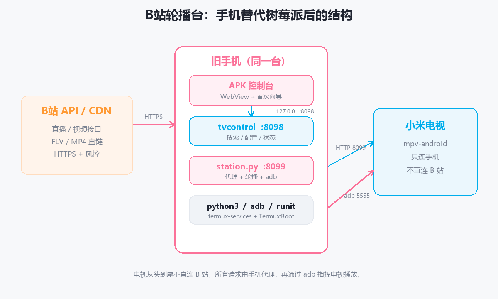
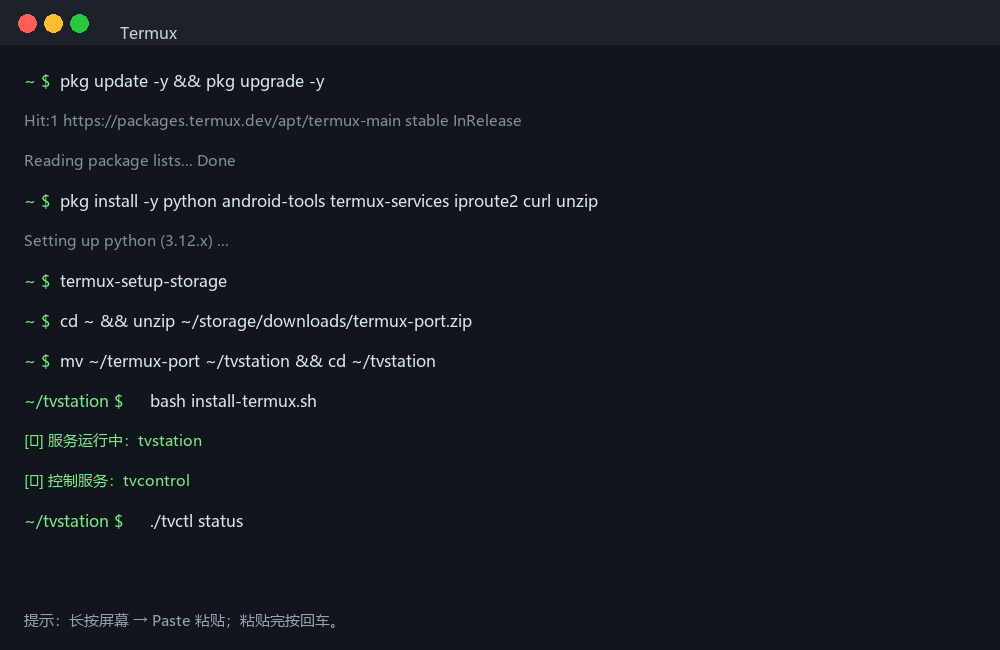
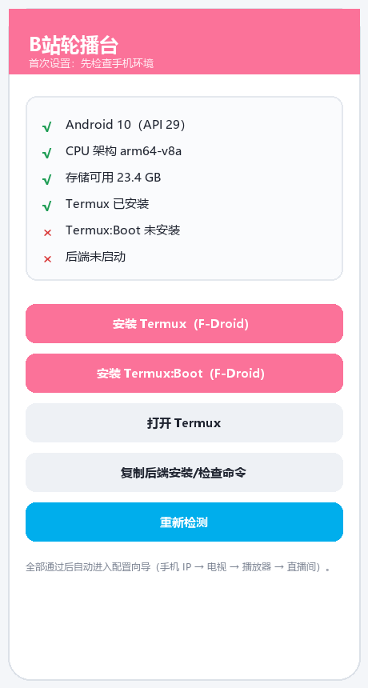
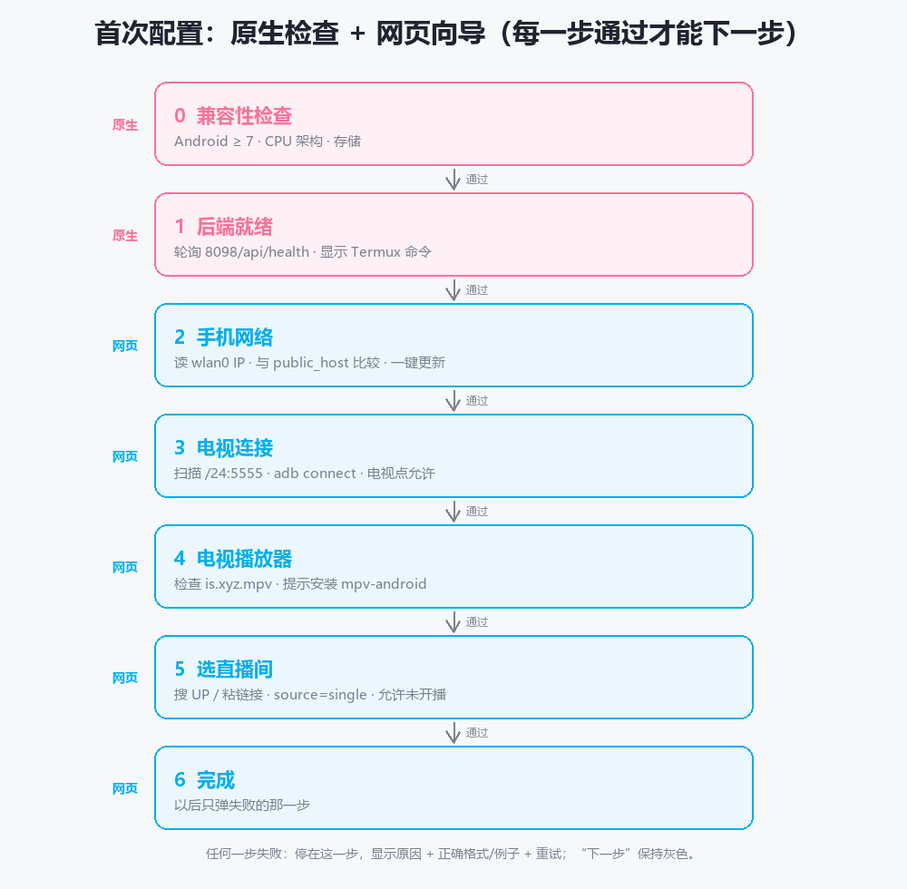
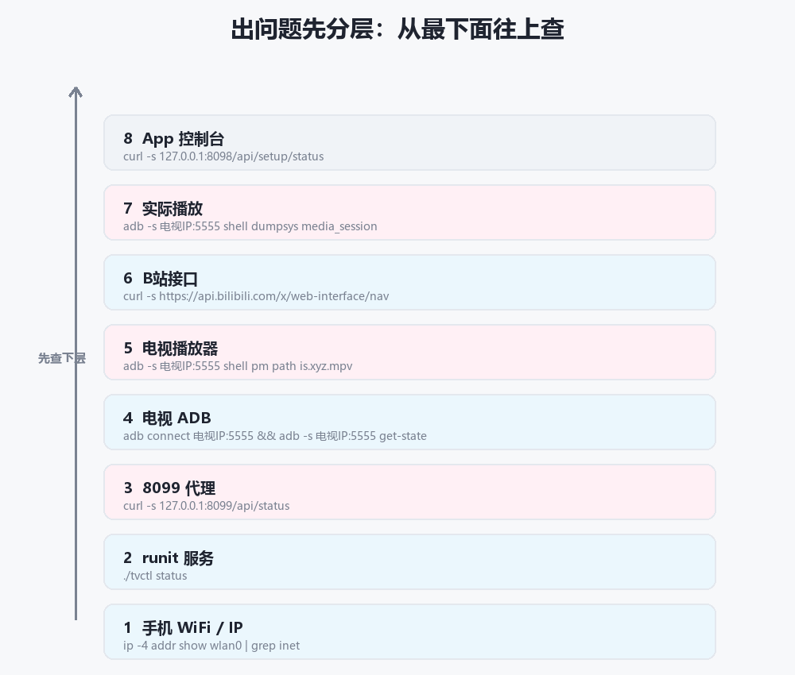

# 全流程调试手册：旧手机 + Termux + APK

> 适用对象：一台**什么都没装**的旧 Android 手机（Android 7.0–11）、一台已装 mpv-android 的小米/Android 电视、一个和电视同一个 WiFi 的路由器。
>
> 目标：按顺序做完，手机 App 能搜到 UP 主、把直播间投到电视、随时换台，并且重启手机后自动恢复。
>
> 说明：本文里的“输入框”都指手机 App 里的输入框；命令都在手机 Termux 里执行。
> 遇到 `~ $` 是提示符，不要输入 `$` 本身。

---

## 0. 最终结构



三个角色：

1. **B站**：提供直播间状态、FLV/MP4 直链。
2. **旧手机**：
   - Termux 里跑 `station.py`（:8099 代理 + 轮播 + adb）
   - Termux 里跑 `control.py`（:8098 控制台/搜索/配置）
   - APK 是遥控器，加载 `http://127.0.0.1:8098`
3. **电视**：只装 mpv-android，只连手机，不直连 B站。

你需要两个文件：

| 文件 | 作用 |
|---|---|
| `termux-port.zip` | 手机后端（Python + 脚本 + 网页控制台） |
| `TVStationRemote-0.2.0.apk` | 手机 App（首次向导 + 控制台） |

---

## 1. 准备清单

| 项目 | 要求 | 怎么确认 |
|---|---|---|
| 手机系统 | Android 7.0–11 | 设置 → 关于手机 → Android 版本 |
| 手机存储 | 至少 2 GB 空闲 | 设置 → 存储 |
| 手机内存 | 建议 2 GB 以上 | 设置 → 关于手机 → 运行内存 |
| 手机供电 | 能长期插电 | 充电线 + 充电头 |
| 电视 | Android，已装 mpv-android，已开网络调试 | 电视设置/应用列表 |
| 网络 | 手机和电视同一 WiFi/网段，路由器没开 AP 隔离 | 两台设备 IP 前三位相同 |
| 电脑 | Windows/Mac，能传文件到手机 | 微信/QQ/USB 均可 |
| 文件 | `termux-port.zip`、`TVStationRemote-0.2.0.apk` | 电脑上准备好 |

> 如果手机是 Android 5/6：当前 Termux 软件包已不支持，建议换一台 Android 7+ 的手机，不要在这上面耗时间。

---

## 2. 检查旧手机是否适配

### 2.1 Android 版本

手机：**设置 → 关于手机 → Android 版本**。

- Android 7.0 及以上：继续。
- Android 5/6：停止，换手机。
- Android 12 及以上：能用，但系统更容易杀后台，后面“电池优化/自启动”要设置得更严格。

### 2.2 存储和内存

- 存储：设置 → 存储，至少 2 GB 空闲。Termux + Python + 依赖大约 500 MB–1 GB。
- 内存：2 GB 以上比较稳；1 GB 也能跑，但更容易被系统杀。

### 2.3 CPU 架构

不用提前查。装完 Termux 后执行：

```bash
uname -m
```

- `aarch64`：64 位 ARM，最稳。
- `armv7l`：32 位 ARM，多数包可用；如果某个包装不上，换 64 位手机。
- `x86_64`：模拟器/少数设备，也能用。

### 2.4 电池与后台

先做这三件事，否则后面“跑几小时就停”：

1. 设置 → 应用 → Termux → 电池 → **不优化/无限制**。
2. 国产 ROM 给 Termux **自启动/后台运行**权限：
   - 小米：安全中心 → 应用管理 → Termux → 自启动、省电策略“无限制”，最近任务里锁定。
   - 华为/荣耀：应用启动管理 → Termux → 手动管理 → 允许自启动/关联启动/后台活动。
   - OPPO/vivo：电池 → 应用耗电管理 → 允许后台运行；自启动打开。
   - 三星：电池 → 后台使用限制 → 永不休眠的应用。
3. 关闭“充到 80% 停止”的电池保护（如果有）。

### 2.5 网络

- 手机和电视连同一个路由器，IP 前三位相同（例如 `192.168.1.x`）。
- 路由器不要开“AP 隔离/访客网络隔离”。
- 强烈建议在路由器里给手机和电视做 **DHCP 固定**。
- Android 10+ 如果开了“随机 MAC”，在该 WiFi 的高级设置里改成“使用设备 MAC”，否则 DHCP 绑定会对不上。

**本步通过标准**：Android ≥ 7；存储 ≥ 2 GB；手机和电视同一网段。

---

## 3. 安装 Termux 和 Termux:Boot

### 3.1 下载

> 不要用 Google Play 的 Termux（实验版）；用 F-Droid。  
> Termux 和 Termux:Boot 必须来自同一个签名来源，不能混装。

手机浏览器打开：

- Termux：<https://f-droid.org/packages/com.termux/>
- Termux:Boot：<https://f-droid.org/packages/com.termux.boot/>

分别点 **Download APK** 安装。

### 3.2 先点开一次 Termux:Boot

安装完 Termux:Boot 后，**点开它的图标一次**，看到界面后可以直接关掉。  
这一步是让 Android 允许它开机自启。

### 3.3 打开 Termux

首次打开会解压 bootstrap，等它出现：

```
~ $
```



**本步通过标准**：

- Termux 能打开到 `~ $`。
- Termux:Boot 能打开一次。
- 没有“App not installed / 签名不一致”。

如果签名冲突：卸载旧的 Termux 及所有插件，再全部从 F-Droid 重装。

---

## 4. 认识 Termux 的基本操作

| 操作 | 怎么做 |
|---|---|
| 粘贴 | 长按屏幕 → **Paste** |
| 执行 | 粘贴后按**回车** |
| 取消当前命令 | **Ctrl + C** |
| 放大字体 | 双指张开 |
| 清屏 | `clear` |

只需要会这 4 个，不需要学 Linux。

---

## 5. 在 Termux 里装依赖

逐段粘贴、回车，等上一段跑完再粘下一段。

```bash
pkg update -y && pkg upgrade -y
```

国内如果很慢/报镜像错误：

```bash
termux-change-repo
```

选清华/中科大/北外等镜像，回车确认，再重跑 `pkg update`。

然后：

```bash
pkg install -y python android-tools termux-services iproute2 curl unzip
```

| 包 | 用途 |
|---|---|
| `python` | 跑 `station.py` / `control.py` |
| `android-tools` | 提供 `adb`，控制电视 |
| `termux-services` | runit 服务管理（`sv`、开机自启） |
| `iproute2` | `ip` 命令，查手机 IP |
| `curl` | 测试接口 |
| `unzip` | 解压代码包 |

### 检查点

```bash
python3 -V
adb version
sv --help 2>&1 | head -1
ip -4 addr show wlan0 | grep inet
```

期望：

- `Python 3.11.x` 或 `3.12.x`
- `Android Debug Bridge version ...`
- `sv` 有输出
- 能看到 `inet 192.168.x.x/24`

**本步通过标准**：四条命令都有正常输出，没有 `command not found`。

---

## 6. 把代码放进手机

### 方法 A：微信/QQ + 文件管理器（推荐给小白）

1. 电脑上把 `termux-port.zip` 发到“文件传输助手/我的电脑”。
2. 手机保存文件。
3. 用文件管理器把 `termux-port.zip` 移动到 **`Download` 根目录**（不是 `Download/WeChat` 里面）。
4. Termux 里：

```bash
termux-setup-storage
```

手机弹权限，点**允许**。然后：

```bash
cd ~
unzip ~/storage/downloads/termux-port.zip
mv ~/termux-port ~/tvstation
cd ~/tvstation
ls
```

### 方法 B：scp（手机和电脑同一 WiFi）

手机：

```bash
pkg install -y openssh
passwd
sshd
whoami
ip -4 addr show wlan0 | grep inet
```

电脑 PowerShell（在 `termux-port` 上一级）：

```powershell
scp -P 8022 -r .\termux-port u0_a123@192.168.1.50:~/
```

手机：

```bash
mv ~/termux-port ~/tvstation
cd ~/tvstation
```

### 检查点

```bash
ls ~/tvstation
```

期望看到：

```
README.md  control.py  install-termux.sh  mode.sh  set-content.sh
station.py  status.sh  tvctl  web  templates  新手搭建.md ...
```

**本步通过标准**：能看到 `station.py`、`control.py`、`web/`、`templates/`、`install-termux.sh`。

如果 `unzip` 找不到文件：

```bash
find ~/storage -name "termux-port.zip"
```

把完整路径替换到 `unzip` 后面。

---

## 7. 第一次安装后端

```bash
cd ~/tvstation
bash install-termux.sh
```

按提示填。示例（你的 IP 和房间号会不同）：

```
== 1/7 电视 ==
  电视 ADB 地址（IP 或 IP:5555） [192.168.10.139:5555]: 192.168.1.23:5555

== 2/7 手机 WiFi 地址 ==
  手机 WiFi IP（电视要能访问它） [192.168.1.50]: 直接回车

== 3/7 轮播内容 ==
  默认模式 live=直播间轮播 / video=列表视频 [live]: 直接回车
  直播间号（英文逗号分隔） [5017134,...]: 5017134
  列表 mid [23191782]: 直接回车
  列表 id [1424266]: 直接回车
```

> 这里先随便选一个直播间即可；App 里还能改。

### 电视授权

脚本执行 `adb connect` 时，电视会弹：

> 允许 USB 调试吗？

勾选**一律允许** → 允许。

如果显示 `unauthorized`：

1. 电视开发者选项里确认“网络调试/USB 调试”打开。
2. 有的电视有“ADB 需要确认”，关掉。
3. 回到 Termux 重跑 `bash install-termux.sh`。

### 安装脚本做了什么

- 写 `~/tvstation/config.json`
- 装 `tvstation`（:8099 代理/轮播）和 `tvcontrol`（:8098 控制台）
- 装开机自启 `~/.termux/boot/00-tvstation`
- 启动并自检

### 检查点 1：服务

```bash
cd ~/tvstation
./tvctl status
```

期望：

```
== 服务 ==
run: tvstation: (pid ...)
run: tvcontrol: (pid ...)
```

### 检查点 2：代理

```bash
curl -s http://127.0.0.1:8099/api/status
```

期望是一个 JSON 数组，例如：

```json
[{"room":5017134,"live":true,"title":"...","online":123}]
```

`[]` 说明还没查到状态，等 10 秒再试。

### 检查点 3：控制台

```bash
curl -s http://127.0.0.1:8098/api/health
```

期望：

```json
{"ok": true, "app": "tvcontrol"}
```

**本步通过标准**：三条都正常。  
如果 `tvcontrol` 是 down：

```bash
./tvctl control
tail -n 50 ~/tvstation/control.log
```

---

## 8. 安装 APK 并走首次配置

### 8.1 安装

把 `TVStationRemote-0.2.0.apk` 传到手机，点开安装；或用电脑：

```bash
adb install -r TVStationRemote-0.2.0.apk
```

Android 会提示“允许安装未知应用”，允许即可。

### 8.2 原生环境检查

打开 App，第一屏是原生检查，不会先加载网页：



它会检查：

- Android 版本、CPU 架构、存储
- Termux 是否安装
- Termux:Boot 是否安装
- `http://127.0.0.1:8098/api/health` 是否就绪

缺什么就点对应按钮：

| 状态 | 操作 |
|---|---|
| Termux 未安装 | 点“安装 Termux（F-Droid）” |
| Termux:Boot 未安装 | 点“安装 Termux:Boot（F-Droid）” |
| 后端未启动 | 点“打开 Termux”，粘贴“复制后端安装/检查命令”里的命令 |
| 都装好了 | 点“重新检测” |

复制出来的命令是：

```bash
pkg update -y && pkg upgrade -y
pkg install -y python android-tools termux-services iproute2 curl unzip
cd ~/tvstation
bash install-termux.sh
./tvctl status
```

**通过标准**：所有行都是 `√`，App 自动进入下一步（WebView）。

> 如果一直显示“后端未启动”：在 Termux 里 `./tvctl status`，确认 `tvcontrol` 在跑；再看 `curl 127.0.0.1:8098/api/health`。

### 8.3 网页首次配置向导



进入 WebView 后，会按顺序走 5 步。**当前步骤没通过，“下一步”是灰的。**

#### 第 1 步：手机网络

- App 自动读当前 `wlan0` 的 IP。
- 如果和 `config.json` 里的 `public_host` 不一致，点“使用当前 IP”。
- 如果显示“没读到 IP”，先确认手机连着 WiFi，再点“重试”。

通过标准：显示“手机网络已正确”。

#### 第 2 步：电视连接

- 点“扫描局域网找电视”，等 1–3 秒；会列出当前网段里 5555 端口开着的设备，显示 IP/型号/状态。
- 点“使用”；或手动输入 `电视IP:5555`。
- 电视弹“允许调试” → 勾选一律允许 → 允许。
- 如果显示 `unauthorized`：去电视点允许，再点“重试”。

通过标准：显示“电视 ADB 已连接”。

#### 第 3 步：电视播放器

- 检查电视上是否装了 `is.xyz.mpv`。
- 没有就按提示装 mpv-android，然后点“重新检测”。

通过标准：显示“电视上已装 mpv-android”。

#### 第 4 步：选直播间

- 输入 UP 名字，例如 `老番茄`，点“搜索 / 播放”。
- 同名会列出候选，点正确的“播放”。
- 或者粘贴：

```
https://live.bilibili.com/5017134
```

- 如果当前没开播，允许完成；会显示“等待开播”，开播后自动播。

通过标准：显示“当前内容：直播间 xxxx · 直播中/等待开播”。

#### 第 5 步：完成

显示手机 IP、电视、播放器、直播间。点“开始使用”进主页。

### 8.4 主页检查

- 顶部显示“已连接”。
- 当前播放显示直播间号/标题。
- 点“停止”能停；点“启动”能起；点“唤醒电视”能亮屏。
- 设置里能看到“手机网络/电视连接/电视播放器/当前直播间”，都有“修改”。

**本步通过标准**：电视出画面，App 能搜、能换台、能停止/启动。

---

## 9. 分层调试：哪一层不对，就查哪一层



从下往上查。每层都有“通过标准”。

### 第 1 层：手机 WiFi / IP

```bash
ip -4 addr show wlan0 | grep inet
```

通过：有 `inet 192.168.x.x/24`。  
不通过：手机没连 WiFi；或连的是蜂窝网。先连和电视同一个 WiFi。

### 第 2 层：runit 服务

```bash
cd ~/tvstation
./tvctl status
```

通过：`run: tvstation` 和 `run: tvcontrol`。  
不通过：

```bash
tail -n 80 station.log
tail -n 80 control.log
```

常见：端口被占、Python 报错、adb 不在 PATH。

### 第 3 层：8099 代理

```bash
curl -s http://127.0.0.1:8099/api/status
```

通过：返回 JSON 数组。  
不通过：服务没起、端口被占、B站接口失败。看 `station.log`。

### 第 4 层：电视 ADB

```bash
adb connect 电视IP:5555
adb -s 电视IP:5555 get-state
```

通过：`device`。  
不通过：

- `unauthorized`：电视上点允许。
- `offline`：电视休眠/断网；唤醒/重连。
- `cannot connect`：电视没开网络调试，或 IP 变了。

### 第 5 层：电视播放器

```bash
adb -s 电视IP:5555 shell pm path is.xyz.mpv
```

通过：返回 `package:/data/app/.../base.apk`。  
不通过：电视没装 mpv-android；去装。

### 第 6 层：B站接口

```bash
curl -s https://api.bilibili.com/x/web-interface/nav | head -c 120
```

通过：返回 JSON（未登录 `code:-101` 也算通，只要有 `wbi_img`）。  
不通过：手机出不了网，或 B站风控；换网络/稍后再试。

App 里搜索：

```
老番茄
```

通过：出现候选列表。  
不通过：看红字提示；可能是搜索风控，改用直播间链接。

### 第 7 层：实际播放

```bash
adb -s 电视IP:5555 shell dumpsys media_session | grep state=
```

通过：`state=3`（播放中）。  
不通过：`state=2` 是暂停；App 会自动补播放键。黑屏看 `dumpsys window | grep mCurrentFocus` 是否有 `is.xyz.mpv`。

### 第 8 层：App 控制台

```bash
curl -s http://127.0.0.1:8098/api/setup/status
```

通过：`"complete": true`，每个 step 都是 `"ok": true`。  
不通过：看哪个 step 是 false，App 会弹对应那一步。

---

## 10. 换 WiFi / 换电视 / 换手机

### 10.1 只是换 WiFi（手机和电视都换）

1. 手机连新 WiFi。
2. 打开 App：
   - 第 1 步会提示“当前 IP 和配置不一致” → 点“使用当前 IP”。
   - 第 2 步点“扫描局域网找电视” → 选新 IP。
3. 点“完成/开始使用”。

如果 App 打不开（后端没起来）：

```bash
cd ~/tvstation
ip -4 addr show wlan0 | grep inet
nano config.json      # 改 public_host 和 tv
./tvctl restart
```

### 10.2 换电视 / 电视恢复出厂

1. 电视装 mpv-android、打开网络调试。
2. App → 设置 → 电视连接 → 修改 → 扫描/输入新 IP。
3. 电视弹允许 → 允许。
4. App → 电视播放器 → 检查。

如果电视 IP 没变但恢复出厂：只需重新授权 + 重装 mpv。

### 10.3 换手机 / 重装 Termux

1. 新手机按第 3–7 节重装 Termux + 后端。
2. 电视会把它当新设备，重新弹“允许调试”。
3. 新手机 IP 可能不同 → App 第 1 步“使用当前 IP”。
4. 电视 IP 可能不同 → 第 2 步扫描。

### 10.4 “设备号”到底是什么

这套系统**不用电视序列号/手机设备号连接**，只用：

- 电视 IP:5555（`tv`）
- 手机 WiFi IP（`public_host`）
- 直播间号（`rooms`）

电视序列号/型号只用于扫描时显示，方便你认出哪台是电视。  
手机 MAC 只影响路由器 DHCP 绑定，不影响 App 连接。

### 10.5 手动重新初始化

App → 设置 → **重新初始化**。  
会从第 1 步重新检查；旧配置在每一步保存前都保留。  
适合：搬家、换路由器、换电视、IP 段整体变化。

---

## 11. 常见错误速查

| 现象 | 原因 | 处理 |
|---|---|---|
| `sv: command not found` | 没装 termux-services | `pkg install termux-services`，重开 Termux |
| `./tvctl status` 显示 down | 服务崩了/端口被占 | `tail -n 80 station.log` |
| `unauthorized` | 电视没允许调试 | 电视点允许；或 `rm -rf ~/.android/adbkey*` 重连 |
| `device offline` | 电视休眠/断网 | 唤醒电视；`adb connect` |
| `adb: no devices` | 电视网络调试没开 | 电视开发者选项打开 |
| 状态一直 `[]` | 手机出不了网/风控 | `curl api.bilibili.com/...`；换网络 |
| 日志 502 | CDN 节点 403/404 | 代码会自动换镜像；全挂是 B站改规则 |
| `Address already in use` | 8099 被占 | 改 `config.json` 的 `port`，`./tvctl restart` |
| 电视黑屏，日志有 `[调度]` | 电视侧问题 | `dumpsys window` 看 mpv 是否前台 |
| 画面停住没声音 | mpv 暂停 | App 自动补键；不行 `./tvctl restart` |
| App 显示“控制服务没有启动” | tvcontrol 没跑 | 打开 Termux：`./tvctl status` |
| App 显示“WebView 太旧” | 系统 WebView 太老 | 应用商店/系统更新 Android System WebView |
| `App not installed` | 签名冲突/空间不足 | 卸载旧版；清空间；重装 |
| `Permission denied` | 脚本没执行权限 | `chmod +x *.sh` 或 `bash install-termux.sh` |
| `unzip: cannot find` | 路径不对 | `find ~/storage -name "termux-port.zip"` |
| 跑几小时就停 | 系统杀 Termux | 电池优化、自启动、wakelock、最近任务锁定 |
| 重启后没自启 | Boot 没点开/没解锁 | 点开 Termux:Boot 一次；解锁后等 1–2 分钟 |

---

## 12. 出问题怎么收集日志

在 Termux 里执行：

```bash
cd ~/tvstation
./tvctl status
tail -n 100 station.log
tail -n 100 control.log
```

App 里：

- 设置 → 当前直播间/电视连接 → 看红字提示
- 主页 → 最近日志 → 刷新

发给我时请带上：

1. 手机型号、Android 版本
2. 电视型号、电视 IP
3. `./tvctl status` 输出
4. `station.log` 最后 100 行
5. `control.log` 最后 100 行
6. App 报错截图

> 分享前把公网 IP、房间号等打码；这些日志只在本机，不会上传。

---

## 13. 附录 A：全部命令清单

### 13.1 首次安装

```bash
pkg update -y && pkg upgrade -y
pkg install -y python android-tools termux-services iproute2 curl unzip
termux-setup-storage
cd ~
unzip ~/storage/downloads/termux-port.zip
mv ~/termux-port ~/tvstation
cd ~/tvstation
bash install-termux.sh
```

### 13.2 看状态

```bash
cd ~/tvstation
./tvctl status
curl -s http://127.0.0.1:8099/api/status
curl -s http://127.0.0.1:8098/api/health
curl -s http://127.0.0.1:8098/api/setup/status
```

### 13.3 电视 ADB

```bash
adb connect 电视IP:5555
adb -s 电视IP:5555 get-state
adb -s 电视IP:5555 shell pm path is.xyz.mpv
adb -s 电视IP:5555 shell dumpsys window | grep mCurrentFocus
adb -s 电视IP:5555 shell dumpsys media_session | grep state=
```

### 13.4 日常

```bash
cd ~/tvstation
./set-content.sh        # 换直播间/合集
./tvctl restart         # 改配置后重启
./tvctl stop            # 停止
./tvctl start           # 启动
./tvctl wake            # 唤醒电视
./tvctl control         # 重启控制服务
```

### 13.5 日志

```bash
tail -f ~/tvstation/station.log
tail -f ~/tvstation/control.log
```

---

## 14. 附录 B：调试记录表

打印/复制到备忘录，每完成一项打勾：

| # | 检查项 | 通过标准 | 完成 |
|---|---|---|---|
| 1 | Android 版本 | ≥ 7.0 | ☐ |
| 2 | 存储 | ≥ 2 GB | ☐ |
| 3 | Termux 安装 | 能到 `~ $` | ☐ |
| 4 | Termux:Boot | 点开过一次 | ☐ |
| 5 | 依赖 | python/adb/sv/ip 都有 | ☐ |
| 6 | 代码 | `~/tvstation/station.py` 存在 | ☐ |
| 7 | 后端安装 | `tvstation` + `tvcontrol` 都 run | ☐ |
| 8 | 8099 代理 | 返回 JSON | ☐ |
| 9 | 8098 控制台 | `{"ok":true}` | ☐ |
| 10 | APK 原生检查 | 全 √ | ☐ |
| 11 | 手机网络 | 当前 IP = 配置 | ☐ |
| 12 | 电视 ADB | `device` | ☐ |
| 13 | mpv | `pm path` 有 package | ☐ |
| 14 | 选直播间 | 内容保存成功 | ☐ |
| 15 | 电视画面 | 10–15 秒出画面 | ☐ |
| 16 | 换台 | 搜另一个能切 | ☐ |
| 17 | 重启自启 | 重启后能自动恢复 | ☐ |

---

## 15. 附录 C：文件清单

| 文件 | 作用 |
|---|---|
| `termux-port.zip` | 手机后端完整包 |
| `TVStationRemote-0.2.0.apk` | 手机 App |
| `station.py` | 8099 代理 + 轮播 + adb |
| `control.py` | 8098 搜索/配置/状态 |
| `web/index.html` | 控制台主页 |
| `web/setup.js` / `web/setup.css` | 首次配置向导 |
| `install-termux.sh` | 后端一键安装 |
| `templates/service-run` | tvstation 服务 |
| `templates/control-run` | tvcontrol 服务 |
| `templates/boot-start` | Termux:Boot 脚本 |

---

> 最后一句话：**先让 Termux 后端跑通（第 7 节），再装 APK（第 8 节）**。  
> 后端没通之前，App 的网页向导打不开，这是正常的；原生检查页会告诉你缺什么。
